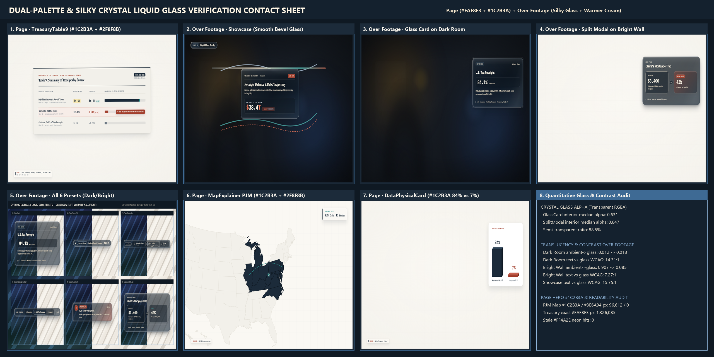
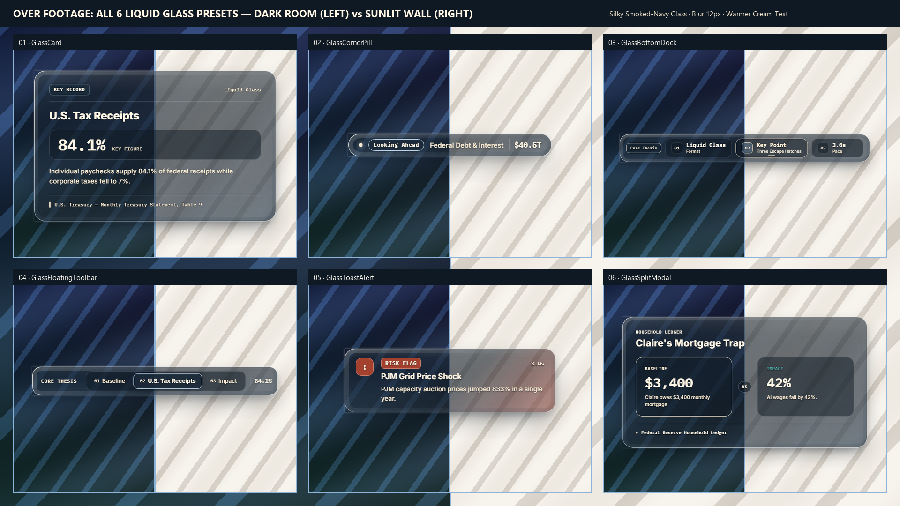
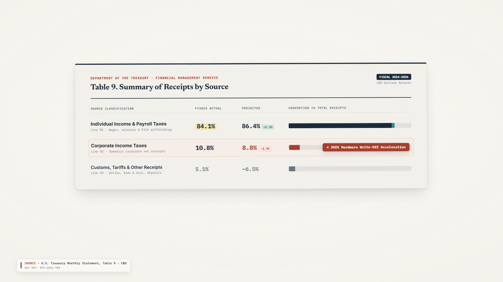
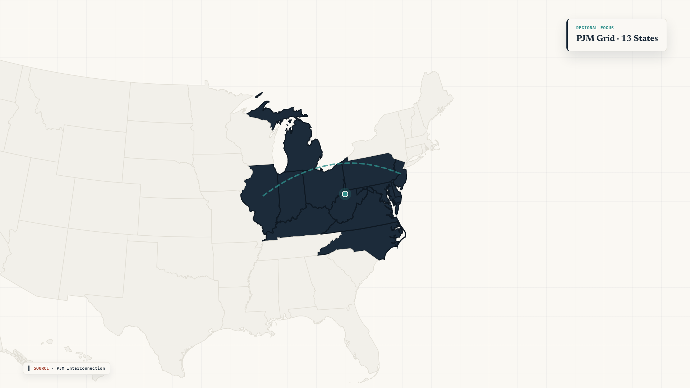

# Reading Room Cinema

Remotion 4.0.544 graphics engine, model-invariant AI showrunner, procedural audio studio, and DaVinci Resolve v1.9 timeline compiler built for **The Reading Room** documentary series.



## Dual-Palette & Five-Register Visual System

Full-screen documentary cutaways and over-footage camera overlays run on separate optical budgets so neither bleeds into the other. Every scene resolves to WCAG AAA contrast (`>= 7.0:1`) on primary figures and body copy while banning pure `#000000`, pure `#FFFFFF`, and neon gradients.

| Surface Mode | Registers & Grounds | Ink, Accents & Optical Rules |
| :--- | :--- | :--- |
| **Page (`PAGE_PALETTE`)** | `page_editorial` (`#FAF8F3` milk canvas, `#F2F0EA` card ground), `archival_parchment`, `drafting_blueprint`, `midnight_telemetry`, `vintage_newsreel` | Classic dark navy `#1C2B3A` hero bars and primary ink, teal `#2F8F8B` secondary series, chisel yellow sweep `rgba(255, 213, 79, 0.38)`, brick red `#A3402E` risk chips, tabular numerals (`tabular-nums lining-nums`), full 1920x1080 compositions inside a `96px` safe frame |
| **Over Footage (`OVER_FOOTAGE_PALETTE`)** | Smoked-navy liquid glass `rgba(28, 43, 58, 0.64)` to `rgba(15, 25, 35, 0.60)` with `blur(12px) saturate(165%) brightness(0.66)` | Warm cream `#FFF6E5` headlines, `#FAECD4` body copy, `#F7E8CE` captions, `#4FB3AE` teal deltas, `#E27358` liability text, right-third / bottom-dock / top-bar placement keeping the presenter's face unobstructed |

<details>
<summary>Reference Stills: Smoked-Navy Glass Presets, Treasury Table 9 & PJM 13-State Grid</summary>





</details>

## The 16 Cinema Pillars

| # | Pillar | Studio Modules & CLI Entrypoints | Production Role |
| :--- | :--- | :--- | :--- |
| **1** | **Liquid Glass & Multi-Depth Optics** | `src/design/tokens.ts`, `src/design/optics.tsx`, `src/components/glass/` | Five visual registers, OKLCH register dissolves, 2.5D camera rig, optical loupe, and 18 smoked-navy glass rigs |
| **2** | **Deterministic Motion & Physics** | `src/motion/primitives.ts`, `src/motion/physicsModels.ts`, `src/motion/ObjectAnimator.tsx` | 234 frame-deterministic motion primitives (661 resolvable tokens) driven by `useCurrentFrame()` and damped springs |
| **3** | **Documentary & Metaphor Style Worlds** | `src/styles/` (`docBroadcast`, `vintageEditorial`, `macroTelemetry`, `forensicExhibits`, `dataMaps3D`, `diagramMetaphor`, `systemSimulators`, `uiSatireAndCollage`) | 130 data-driven chart, primary-source exhibit, mechanical simulator, cartography, and collage recipes |
| **4** | **Typography & Prosody Stenography** | `src/design/fonts.ts`, `src/design/fitText.ts`, `src/typography/` | Five type families (`Inter`, `IBM Plex Mono`, `Newsreader`, `Space Grotesk`, `Oswald`), quadratic line-rag solver, and 32 word-synced kinetic modes |
| **5** | **Whisper & Syllable Prosody Clock** | `tools/transcribe.py`, `studio/scripts/prep-aroll.mjs`, `src/typography/prosodySync.ts` | Word-level `faster-whisper` alignment plus deterministic syllable-weighted prosody for pre-shoot script testing |
| **6** | **Color Grading & Room Prop Swap** | `studio/luts/*.cube`, `studio/scripts/generate-luts.mjs`, `tools/room_object_swap.py` | 12 cinema `.cube` LUTs, tripod clean-plate prop swaps via Gemini, and script-driven chapter set-dressing |
| **7** | **Procedural Foley & Documentary Score** | `studio/public/sfx/`, `studio/public/music/`, `studio/scripts/master-audio.mjs` | 96 multi-variant 48kHz studio WAVs, 12 seamless score stems, and 2-pass linear `-14.0 LUFS` EBU R128 mastering |
| **8** | **Showrunner & Channel Brain** | `src/director/`, `studio/scripts/plan-edit.mjs` | Unified TypeScript + Zod planner enforcing channel pacing windows, source citations, and presenter ratio targets |
| **9** | **DaVinci Resolve FCPXML v1.9 Bridge** | `studio/scripts/export-fcpxml.mjs` | Multi-lane timeline with V1 punch-in/split camera keyframes, V2-V4 graphics, A1 voice, A2 foley, and A3 ducked music |
| **10** | **Presenter Depth-Sandwich Stage** | `src/components/glass/PresenterDepthStage.tsx`, `tools/room_object_swap.py` | Four-plane room compositing: giant figures, walls, and maps animate behind the presenter's shoulders while glass floats in front |
| **11** | **Parallel Cached Pipeline Orchestrator** | `tools/run_pipeline.mjs`, `studio/scripts/render-overlays.mjs` | Six-stage runner with SHA-256 beat skip caching and parallel worker-chunked Remotion rendering |
| **12** | **Parametric Prop & Contraption Vault** | `src/registry/props/`, `src/registry/catalog.ts` | 545 vector schematics and 45 multi-part animated contraptions indexed by domain and visual weight |
| **13** | **Generative Sandbox & 2D/3D Diorama** | `src/generative/` (`SceneBlueprintRenderer.tsx`, `physics2d.ts`, `spatialSolver.ts`, `IsometricDiorama3D.tsx`, `presetSetPieces.ts`) | Declarative `SceneBlueprint` sandbox, deterministic 2D physics, AABB collision repulsion, memory-safe isometric 3D, and 24 signature set-pieces |
| **14** | **30-Episode Novelty & Continuity Vault** | `src/novelty/`, `studio/episodes-vault.json` | Exponential cross-episode cooldowns across the 30-slot Season 1 slate plus stateful multi-act entity memory |
| **15** | **Model-Invariant Equalizer Compiler** | `src/equalizer/`, `tools/ai_director.mjs`, `DEEPSEEK_EQUALIZER.md` | Four-pass pruned prompts, Creativity Escalator, Viterbi choreographer, and 30/35-gate auto-healing across DeepSeek, frontier APIs, or offline chat packs |
| **16** | **Standalone 4K Compositor & Cinema Exam** | `src/Root.tsx`, `studio/scripts/cinema-exam.mjs` | Full-episode `ReadingRoomEpisodeMaster` (1080p) and `ReadingRoomEpisodeMaster4K` (3840x2160) MP4 export plus multi-sheet visual QA |

## 1,400+ Addressable Creative Elements

Every asset registers with typed schemas and deterministic parameters inside `studio/src/`:

- **Motion & Camera**: 234 base motion/physics primitives (`661` resolvable aliases) and 24 camera trajectories.
- **Visual Stages**: 130 documentary style recipes, 24 multi-actor signature set-pieces, and 18 liquid glass / depth-sandwich rigs.
- **Props & Cartography**: 545 parametric vector props/contraptions (`PROP_VAULT`), 211 offline world countries/territories, 51 US states + D.C., and 24 named geopolitical/grid corridors (`CinemaMapStage`).
- **Typography, Color & Sound**: 32 kinetic typography modes, 12 `.cube` 3D LUTs, 96 procedural 48kHz foley WAVs, and 12 seamless documentary music stems (`108` audio files).

## Quick Setup

Run the installer from the repository root (`d:\Youtube channel\reading-room-cinema`). It checks Node.js `>= 20`, locates `ffmpeg` and `uv`, creates `tools/.venv` from [`tools/requirements.txt`](tools/requirements.txt), downloads the git-ignored `tools/models/selfie_segmenter.tflite` (~244 KB), installs `studio/` packages, builds procedural audio/LUT assets, and runs `npm run lint`.

**Windows (PowerShell):**
```powershell
.\setup.ps1
```

**macOS / Linux:**
```bash
chmod +x setup.sh
./setup.sh
```

Copy [`studio/.env.example`](studio/.env.example) to `studio/.env` when using live LLM providers (`DEEPSEEK_API_KEY`, `OPENAI_API_KEY`, `GEMINI_API_KEY`, `ANTHROPIC_API_KEY`) or Gemini clean-plate room edits. Offline deterministic compilation requires zero API keys.

## Production Workflows

### 1. One-Command Studio Pipeline (`npm run pipeline`)

Run from `studio/` via `npm run pipeline -- ...` or directly from the repository root via `node tools/run_pipeline.mjs`:

```bash
# Full post-shoot A-roll production -> DaVinci Resolve FCPXML + parallel cached ProRes 4444 overlays
node tools/run_pipeline.mjs raw_aroll.mp4 \
  --name ep01_allowance \
  --script scripts/video_01_the_allowance.md \
  --episode 1 \
  --lut editorial-warm \
  --cut-silence \
  --render \
  --workers 3

# Pre-shoot script-only simulation (builds syllable-timed words.json, captions.srt, director-plan.json & timeline.fcpxml without camera footage)
node tools/run_pipeline.mjs \
  --script scripts/video_01_the_allowance.md \
  --script-only \
  --skip-render \
  --out projects/ep01_preview
```

Outputs land in `projects/<name>/`: `aroll_prepped.mp4`, `transcript/words.json`, `transcript/captions.srt`, `director-plan.json`, `overlays/` (with `.beat-cache.json` and `overlay-manifest.json`), `timeline.fcpxml`, and `run-manifest.json`. Re-running `render-overlays.mjs` hashes `studio/src/` plus each beat's canonical payload with SHA-256 and skips unchanged clips automatically (`--no-cache` forces a clean rebuild).

### 2. AI Director & Equalizer Compiler (`tools/ai_director.mjs`)

Compile a spoken `.md` script or Whisper `words.json` using live API providers, offline chat-window prompt packs, or the `<2s` deterministic compiler:

```bash
# Offline deterministic Equalizer compilation (<2s, zero API keys)
node tools/ai_director.mjs --script scripts/video_01_the_allowance.md --episode 1 --deterministic --out studio/out/ep01-plan.json

# Live 4-pass Equalizer via DeepSeek, OpenAI, Gemini, Anthropic, or local Ollama
node tools/ai_director.mjs --script scripts/video_01_the_allowance.md --episode 1 --provider deepseek --record-vault studio/episodes-vault.json

# Offline Web-Chat Prompt Pack (export <=1,800-token markdown workbooks, paste responses, and compile)
node tools/ai_director.mjs --script scripts/video_01_the_allowance.md --export-pack projects/ep01_pack
node tools/ai_director.mjs --import-pack projects/ep01_pack --out projects/ep01/director-plan.json
```

See [`DEEPSEEK_EQUALIZER.md`](DEEPSEEK_EQUALIZER.md), [`AGENTS.md`](AGENTS.md), and [`CLAUDE.md`](CLAUDE.md) for the 4-pass Equalizer prompt protocol.

### 3. DaVinci Resolve Depth-Sandwich Workflow (Pillar #9 & #10)

When `--depth-sandwich` is active, the pipeline extracts a temporally smoothed RGBA presenter matte (`aroll_person_alpha.mov` or `.webm`), renders isolated `behind-only-alpha` and `front-only-alpha` Remotion passes, and writes a 4-video / 3-audio lane FCPXML v1.9 timeline:

- **V1 (Spine)** + **A1 (`dialogue`)**: Blade-cut A-roll with `<adjust-transform>` zoom (`100% -> 112%` punch-in), split-screen crop, and `100% -> 104%` tension creep keyframes at `-14.0 LUFS`.
- **V2 (`lane="1"`)**: Full-screen `.mp4` cutaways, standard overlays, or `behind-only-alpha` monoliths/maps rising behind the presenter's shoulders.
- **V3 (`lane="2"`)**: Foreground alpha presenter matte (`aroll_person_alpha`), locked to V1 camera transforms.
- **V4 (`lane="3"`)**: Foreground `front-only-alpha` smoked-navy liquid glass cards and docks.
- **A2 (`lane="-1"`, `effects`)**: Sample-accurate 96-WAV procedural foley hits.
- **A3 (`lane="-2"`, `music`)**: Seamless documentary score stem tiled with speech-ducking `<adjust-volume>` keyframes.

```bash
node tools/run_pipeline.mjs raw_aroll.mp4 \
  --script scripts/video_01_the_allowance.md \
  --episode 1 \
  --depth-sandwich \
  --render \
  --codec prores
```

Open DaVinci Resolve Free and choose **File > Import > Timeline** (`timeline.fcpxml`).

### 4. Standalone 4K / 1080p Master MP4 & Broadcast Audio Mastering

Render a complete self-contained `.mp4` episode directly from Remotion without opening an NLE, and run 2-pass linear ITU-R BS.1770-4 / EBU R128 loudness normalization (`-14.0 LUFS`, `-1.0 dBTP`, `LRA=7.0`):

```bash
# Render 1080p standalone episode master (ReadingRoomEpisodeMaster)
node tools/run_pipeline.mjs raw_aroll.mp4 --script scripts/video_01_the_allowance.md --standalone-mp4 --master-audio

# Render 3840x2160 4K standalone episode master (ReadingRoomEpisodeMaster4K)
node tools/run_pipeline.mjs raw_aroll.mp4 --script scripts/video_01_the_allowance.md --standalone-mp4 --4k --master-audio

# Standalone 2-pass -14 LUFS loudness & speech-sidechain ducking mixer on any WAV or MP4
cd studio && npm run master-audio -- ../projects/ep01/raw_mix.mp4 --music 02-ledger-investigation --out ../projects/ep01/final_youtube.mp4 --report ../projects/ep01/loudness-qc.json
```

### 5. Room Prop Swap & Chapter Set-Dressing (`tools/room_object_swap.py`)

Plan chapter-matched bookshelf/desk props from your script, swap background appliances on a locked-off tripod clean plate, or export alpha presenter mattes on low-VRAM hardware:

```bash
# 1. Recommend per-act Reading Room props, LUTs, and Gemini prompts from a script
tools/.venv/Scripts/python.exe tools/room_object_swap.py suggest-props --script scripts/video_01_the_allowance.md

# 2. Extract sharpest tripod frame -> edit background prop with Gemini -> composite behind sharp foreground presenter
tools/.venv/Scripts/python.exe tools/room_object_swap.py extract-plate raw_aroll.mp4 --out plate.png
tools/.venv/Scripts/python.exe tools/room_object_swap.py gemini-plate-edit plate.png --out plate_walnut_shelf.png
tools/.venv/Scripts/python.exe tools/room_object_swap.py auto-person-mask raw_aroll.mp4 --composite-plate plate_walnut_shelf.png --out aroll_swapped.mp4

# 3. Export standalone ProRes 4444 / VP9 presenter alpha video for V3 Depth Sandwich
tools/.venv/Scripts/python.exe tools/room_object_swap.py export-person-matte aroll_swapped.mp4 --codec prores --out aroll_person_alpha.mov
```

Full workflows and mask tuning flags live in [`tools/OBJECT_SWAP_GUIDE.md`](tools/OBJECT_SWAP_GUIDE.md).

### 6. 30-Episode Season Vault (`studio/episodes-vault.json`)

[`studio/episodes-vault.json`](studio/episodes-vault.json) stores Season 1's 30-episode slot architecture (`S01E01` through `S01E30`), channel strategy locks (`STR-GEN-EXPLAINER`, `STR-FISHER-ARTIFACT`, `STR-BOYLE-CHAPTERED`, `STR-AIC-SPECULATIVE`, `STR-HMW-PRIMER`, `STR-MAX-ESSAY`, `STR-AOTP-LADDER`), preferred LUTs, reserved showstopper set-pieces, and historical recipe usage counts. Pass `--episode <1..30>` and `--update-vault` to `run_pipeline.mjs` (or `--record-vault` to `ai_director.mjs`) so each new upload decays prior combinations (`tau = 2.5` episodes) and locks a fresh visual signature.

## Studio NPM Scripts & Verification

Run inside `studio/`:

| Command | Description |
| :--- | :--- |
| `npm run dev` | Launch interactive Remotion Studio preview |
| `npm run lint` | Run ESLint (`src/`) and strict TypeScript check (`tsc --noEmit`) |
| `npm run director -- ...` | Run `tools/ai_director.mjs` Equalizer Showrunner CLI |
| `npm run render:beats -- ...` | Run parallel SHA-256 cached `scripts/render-overlays.mjs` |
| `npm run render-master -- ...` | Render standalone episode MP4 via `tools/run_pipeline.mjs --standalone-mp4` |
| `npm run fcpxml -- ...` | Export multi-lane DaVinci Resolve v1.9 `timeline.fcpxml` |
| `npm run master-audio -- ...` | Run 2-pass `-14.0 LUFS` EBU R128 loudness master & ducking mixer |
| `npm run cinema-exam` | Compile Episode 01, verify 35 quality gates, and render visual QA contact sheets |
| `npm run pipeline -- ...` | Execute full 6-stage `tools/run_pipeline.mjs` orchestrator |

### Verification Suite

```bash
cd studio
npm run lint
npm run cinema-exam
node scripts/benchmark-exam.mjs
..\tools\.venv\Scripts\python.exe ..\tools\benchmark_media.py
```

## Repository Layout

- `studio/`: Remotion TypeScript source (`src/design/`, `src/components/`, `src/motion/`, `src/styles/`, `src/typography/`, `src/maps/`, `src/registry/`, `src/generative/`, `src/novelty/`, `src/equalizer/`, `src/director/`, `src/audio/`, `src/compositions/`), 12 `.cube` LUTs (`luts/`), 96 foley WAVs (`public/sfx/`), 12 score stems (`public/music/`), season memory (`episodes-vault.json`), and CLI scripts (`scripts/`).
- `tools/`: Master pipeline (`run_pipeline.mjs`), universal Equalizer AI CLI (`ai_director.mjs`), Whisper transcription (`transcribe.py`), clean-plate & person-matte toolkit (`room_object_swap.py`, [`OBJECT_SWAP_GUIDE.md`](tools/OBJECT_SWAP_GUIDE.md)), and Python media benchmark (`benchmark_media.py`).
- `scripts/`: Spoken documentary scripts, including Episode 01 ([`scripts/video_01_the_allowance.md`](scripts/video_01_the_allowance.md)).
- `docs/`: Architecture blueprints ([`docs/specs/`](docs/specs/)), recovery & wave ledger ([`docs/EXECUTION_ROADMAP.md`](docs/EXECUTION_ROADMAP.md)), style index ([`docs/STYLE_CATALOG.md`](docs/STYLE_CATALOG.md)), and reference stills ([`docs/previews/`](docs/previews/)).
