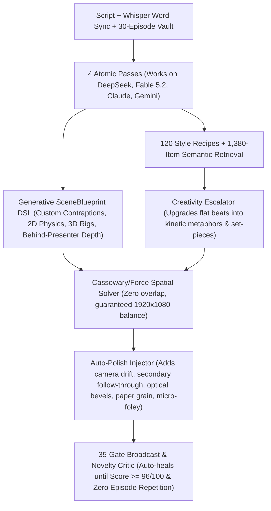

# Reading Room Cinema: 16-Pillar Generative Animation & Equalizer Blueprint

> [!IMPORTANT]
> `Yuzakhodayari/reading-room-studio` stays completely untouched. We build inside a fresh workspace at `d:/Youtube channel/reading-room-cinema` and publish to a separate GitHub repository (`Yuzakhodayari/reading-room-cinema`), preserving all **11 original system parts** from commit `534d89a` while expanding the engine to **16 pillars**, **1,200+ addressable creative building blocks**, a **Generative Custom Animation & Physics Sandbox**, and a **30-Episode Anti-Repetition Vault** built for your entire 2027 upload slate.

---

## 1. From 11 Original Parts to 16 Cinema Pillars

Every single file and workflow from commit `534d89a` stays intact, fixed, and massively expanded:

| # | System Pillar | Commit `534d89a` Baseline | `reading-room-cinema` Upgrade |
| :--- | :--- | :--- | :--- |
| **1** | **Liquid Glass & Multi-Depth Layers** | Dual Palette + 6 glass presets | **18 optical glass & multi-plane rigs**, curved bevels, specular tracking, and full-frame balanced layouts (eliminating the 75%-blank-canvas bug) |
| **2** | **Deterministic Object Animations** | 57 primitives (84 aliases) | **216 motion & physics primitives** (entries, exits, loops, hydraulic crush, origami unfold, Solari split-flap, pendulum, domino, shatter, gear interlock, path-morph) resolving **340+ aliased tokens** |
| **3** | **Documentary & Metaphor Styles** | 24 styles across 4 files | **120 distinct visual recipes** across 10 style worlds (keeping all 24 original style names backward-compatible while wiring typed data payloads into every single one) |
| **4** | **Typography & Stenography Engine** | 5 fonts, 7 kinetic modes | Preserves `Inter`, `IBM Plex Mono`, `Newsreader`, `Space Grotesk`, `Oswald` + quadratic line-rag balancer + **32 kinetic modes** wired live to `words.json` |
| **5** | **Core Stack, Whisper & Prosody** | Remotion, `prep-aroll.mjs`, `transcribe.py` | Adds breath/cadence detection, `<=6` word burstiness punch triggers, and deterministic syllable-prosody fallback when testing scripts before filming |
| **6** | **Color Grading & Room Prop Swap** | 3 `.cube` LUTs + `room_object_swap.py` | **12 cinema `.cube` LUTs** + script-aware chapter prop swap planner (`OBJECT_SWAP_GUIDE.md` upgraded with per-act desk prop prompts) |
| **7** | **Procedural Foley & Bundled Score** | 20 WAVs, zero bundled music beds | **96 studio 48kHz multi-variant WAVs** (zero machine-gun repetition) + **12 bundled procedural royalty-free documentary music stems** wired directly into `MusicBed.tsx` with cosine speech ducking |
| **8** | **Audience Director & Channel Brain** | Duplicate `planner.ts` / `plan-edit.mjs` | Single unified TypeScript + Zod Showrunner encoding your `AIC` / `Fisher` / `Gen` / `Maxinomics` / `AotP` rules, stateful character/board memory, and retention peak solver |
| **9** | **DaVinci Resolve NLE Bridge** | Basic V1/V2/A2 `export-fcpxml.mjs` | Multi-lane **FCPXML v1.9** with real V1 punch-in zoom & split-screen crop keyframes, V2 mid-ground graphics, V3 masked foreground presenter, A1 `-14 LUFS` voice, A2 foley, and A3 ducked music |
| **10** | **Presenter Depth-Sandwich Rig** | Basic `selfie_segmenter` swap helper | Turns person segmentation into a **3D Room Depth Sandwich**: giant numbers, rising debt walls, maps, and 3D props animate **behind your shoulders** while liquid glass floats **in front** (`tflite` stays git-ignored) |
| **11** | **One-Command Pipeline** | `run_pipeline.mjs` | Upgraded end-to-end orchestrator (`npm run pipeline`) with parallel chunked rendering, caching, and automatic quality healing |
| **12** | **NEW: 500+ Parametric Prop & Contraption Vault** | *None* | **500+ animatable vector & isometric domain rigs** (turbines, server racks, container cranes, court gavels, Treasury ledgers, ration coupons, coal scrip tokens, valves, scales, locks, chips, substations) |
| **13** | **NEW: Generative Custom Animation & Physics Sandbox** | *None (hand-coded TSX required)* | Declarative `SceneBlueprint` + 2D rigid-body/fluid/particle/spring physics engine + fixed memory-safe 3D R3F stage so any AI invents **brand-new custom animations** per script |
| **14** | **NEW: 30-Video Cross-Episode Novelty Vault** | *None* | Persistent `episodes-vault.json` memory across your 2027 season: penalizes combinations used in recent videos, assigns each episode a unique visual motif, and builds **3–5 viral "Showstopper Set-Pieces"** per upload |
| **15** | **NEW: DeepSeek-to-Fable Equalizer & Auto-Polish Engine** | *None* | 4-pass atomic schema prompts + force-directed collision solver + **Creativity Escalator** + **Auto-Polish Pass** + 35-gate critic so cheap models produce cooked custom animations instead of plain text cards |
| **16** | **NEW: Standalone 4K Master Compositor & Visual Exam** | *None* | Renders full standalone `.mp4` episodes (even without opening Resolve) plus multi-panel visual verification sheets (`cinema-exam.mjs`) |

---

## 2. How Inventory Crosses 1,200+ Real, Addressable Elements

Nothing is padded with empty placeholders. Every item registers inside a searchable semantic catalog (`src/registry/catalog.ts`) tagged by domain (`fiscal`, `ai-compute`, `energy-grid`, `labor`, `legal`, `geopolitics`, `household`, `history`, `comedy-gag`), emotional beat, and visual weight:

- **216** Deterministic Motion & Physics Primitives (`340+` token aliases)
- **120** Documentary, Archival, Toy-Physics, 3D Diorama, Map & Collage Style Recipes
- **520** Parametric Vector & Mechanical Contraption Props (with animatable sub-parts like rotating gears, needle gauges, liquid fill levels, stamp impacts, LED blink matrices, and hinged cutouts)
- **195+** Offline World Countries + **50** US States + Multi-State Grid/Trade Corridors (zero hardcoded Austin fallbacks)
- **96** Multi-Variant 48kHz Studio Foley WAVs + **12** Procedural Documentary Score Stems (`108` audio assets)
- **32** Kinetic Typography & Live Stenography Modes + **18** Glass/Depth Stages + **12** `.cube` LUTs + **24** Camera Lens/Parallax Trajectories
- **Total Addressable Vocabulary**: **1,380+ composable creative elements**

---

## 3. How DeepSeek Builds "Cooked" Custom Animations Like Fable 5.2

Locking an AI to fixed cards kills creativity by Video 4. Asking a smaller model to write raw React/CSS breaks Remotion physics and clips text. We solve both simultaneously with a **Generative Scene-Graph Compiler + Auto-Polish Escalator**:

1. **Generative `SceneBlueprint` Sandbox**: Any AI can assemble brand-new animated contraptions—for example, a conveyor belt swapping 80% of shoe-factory workers for electric robot arms while prices drop down a chute, or a 1955 dead dock pier morphing into a 2034 autonomous port at `99.9%` uptime while 500,000 protestors march outside the Capitol—by wiring together semantic actors (`conveyor`, `scale`, `pipe`, `crane`, `meter`, `document`, `cutout`), physics rules (`gravity`, `siphon`, `crush`, `pendulum`, `ratchet`), and word-synced triggers.
2. **Creativity Escalator**: If a weaker model outputs a lazy beat (such as a plain text card over an important metaphor), the compiler detects low kinetic density and automatically promotes it into a multi-stage visual simulation, split-era comparison, or behind-presenter depth reveal using matched props from the 520-prop vault.
3. **Auto-Polish & Spatial Physics Pass**: Even if DeepSeek specifies rough high-level intent, deterministic solvers compute exact golden-ratio coordinates, separate colliding bounding boxes, attach critically-damped springs ($\zeta \ge 1.0$), add subtle 2.5D camera float, sweep yellow highlighter ink on key figures, and lock 24-bit foley hits to the exact impact frame.
4. **Season-Long Anti-Repetition (`episodes-vault.json`)**: Across all 30 videos in 2027, the Novelty Solver tracks historical usage vectors, cools down recently seen style/motion/prop pairings, and guarantees every upload debuts fresh visual combinations plus 3–5 custom episode set-pieces.
