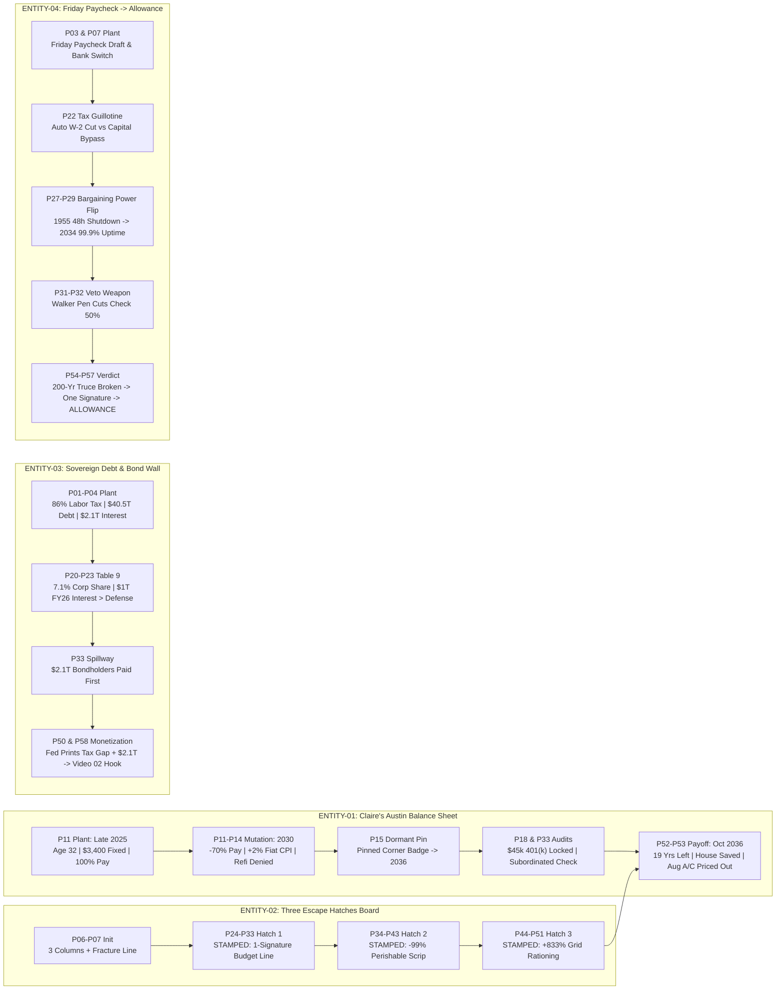

# Flagship Visual Architecture & Showrunner Specification: `video_01_script.md`

Source script analyzed: [video_01_script.md](file:///d:/Youtube%20channel/video_01_script.md#L1-L115)

---

## 1. Structural Spine & Act Map

### 1.1 Channel Strategy Packet & Pipeline Fit
* **Primary Strategy & Engine**: `STR-GEN-EXPLAINER` (`explainer` spine, Gen `5x` voice) fused with **Max Fisher (`6x`) artifact + numbered-board investigation** (`Table 9`, `CBO 2036`, `Three Escape Hatches`) and **AI In Context (`7x`) dated near-future restraint** (Claire's `2025 -> 2030 -> Oct 2036` household arc, dry deadpan delivery, explicit uncertainty hedge).
* **Forbidden Engines (`R43`)**:
  1. `clocked` (`R44`): Banned. No historical 72-hour crisis exists; inventing hour-stamps for 2030 or 2036 breaks source trust (`R39`/`T43`). Dates stay strictly at macro or archival resolution (`late 2025`, `July 2026`, `Oct 29, 2026`, `2030`, `2034`, `Oct 2036`, `June 2016`, `Dec 1, 1941`).
  2. `street` & `field` (`R46`): Banned. Studio archival, ledger, and balance-sheet investigation with zero man-on-the-street or ride-along footage.
  3. `ladder-only` (`R45`): Banned as primary spine because stakes center on household solvency and worker bargaining power, though an AotP-style 4-rung physical power ladder (`P46`) runs inside Act VI.
* **Quantitative Script Telemetry**:
  * **Paragraphs**: `58` spoken paragraphs across `115` lines (odd lines `L001..L115`).
  * **Word Count**: `3,323` whitespace-delimited words (`3,398` lexical tokens splitting hyphenated compounds).
  * **Sentence Metrics**: `199` sentences; mean length `16.70` words/sentence (target corpus band: `15.0–18.0`).
  * **Spoken Runtime (`155 WPM`)**: `21.44` minutes = **`21:26`** (`1,286` seconds) continuous speech; **`~22:20`** locked picture cut after inserting `0.5s–1.0s` breath holds on the 14 short punches and 6 act breaks.
* **Channel Restraint & Structural Rule Audit**:
  * `R01` Hook inside 15s (`<=60w`): `P01` lands the `86%` paycheck tax fact, `\$40.5T` debt, and core thesis question in **`58` words** (`00:00–00:22`, `0.017`).
  * `R02` / `R04` Thesis & Roadmap (`<=0.12`): Question locked at `0.017` (`P01`); 3-hatch numbered board locked at `0.088–0.114` (`P06–P07`).
  * `R03` Kitchen-Table Stakes (`<=0.10`): Rent on the 1st, Friday paycheck draft, and `\$19.1T` household debt (`70%` fixed mortgages) land at `0.017–0.048` (`P02–P03`).
  * `R05` / `L12` Narrator Stake (`<=0.15`): Age `18 -> 28` mortgage/career horizon lands at `0.075–0.088` (`P05`).
  * `R08` Optional Sponsor Seam: Script runs ad-free (AIC flagship pacing). If a bridged Gen sponsor is inserted later, the exact structural slot sits between `P18` and `P19` (`frac 0.302`, `06:28`), right after the 401(k) rebuttal and before `"Which brings us right back to your first instinct"`.
  * `R19` / `L38` Fair Adversary Concessions (5 total, blocking `R40` polemic drift): Silicon Valley manufacturing unit-cost credit (`P08–P09`), modern fiat Fed vs 1933 gold standard (`P13`), 60% US family stock ownership (`P18`), `\$200B` Nvidia capex becoming supplier revenue (`P21`), and 10–15 year grid buildout response (`P49`).
  * `A32` / `A35` / `A36` Calibration + Ownership Action (`0.933–0.960`, `P54`): Explicit non-advice + timing humility + concrete balance-sheet shift (`productive equity, land, or energy` vs max 30-year debt).
  * `R25` / `L35` / `T39` Bookend Verdict + CTA (`0.960–1.000`, `P55–P58`): Closes on the 200-year `Friday paycheck` bookend, `one signature` callback, `"We call that an allowance"` (`P57`, `0.991`), and a `10-second` next-video bridge (`P58`, final `0.8%`, zero mid-video subscribe asks).

### 1.2 Seven-Act Structural Map

| Act | Span (Paras / Lines) | Words | Norm. Frac | Timecode (155 WPM) | Act Function & Turn Architecture | Primary Visual Engine |
| :--- | :--- | :---: | :---: | :---: | :--- | :--- |
| **Act I** | `P01–P07` (`L001–L013`) | 380w | `0.000–0.114` | `00:00–02:27` | **Cold Open & Master Board**: `86%` labor tax vs `\$40.5T` debt; Musk `2036` abundance claim vs landlord draft & CBO `\$2.1T/yr` interest wall; age 18->28 stake; 3 Escape Hatches unveiled and fractured. | `ARCH-01`, `ARCH-02`, `ARCH-04` |
| **Act II** | `P08–P15` (`L015–L029`) | 393w | `0.114–0.233` | `02:27–04:59` | **Micro Squeeze**: Fair credit on `\$120` shoe unit-cost drop -> Palo Alto whiteboard hits Claire's `\$3,400` 30-year Austin mortgage (`-70%` pay cut in 2030); Fisher 1933 vs 2% fiat Fed; why Fed reflation traps Claire worse; `2036` pin. | `ARCH-05`, `ARCH-06`, `ARCH-07` |
| **Act III** | `P16–P23` (`L031–L045`) | 570w | `0.233–0.404` | `04:59–08:40` | **Macro Divergence & Tax Plumbing**: Post-2017 output/pay gap (`53%` labor share, lowest since 1947); `\$820B` AI capex & negative FCF; 90/9/1 stock wealth rebuttal; `Table 9` (`86%` labor vs `7.1%` corporate tax, July 2025 100% write-off, Irish IP, portfolio loans, `\$1T` net interest > defense). | `ARCH-07`, `ARCH-01`, `ARCH-08` |
| **Act IV** | `P24–P33` (`L047–L065`) | 521w | `0.404–0.561` | `08:40–12:02` | **Escape Hatch #1 (Government Check)**: UHI / American Equity Fund; `1955` Rotterdam/Detroit strike vs `2034` `99.9%`-uptime autonomous port; Alaska PFD test (`\$2,052 -> \$1,022` Walker veto, *Wielechowski*, `\$1,000` in 2025); federal bondholder priority spillway. | `ARCH-04`, `ARCH-09`, `ARCH-08` |
| **Act V** | `P34–P43` (`L067–L085`) | 580w | `0.561–0.735` | `12:02–15:46` | **Escape Hatch #2 (Universal Basic Compute)**: Altman GPT-7 slice; Uber 4-month AI budget blowout; `-99%` token deflation + Tuesday airline-seat spoilage; `\$100k` cloud credits = `\$0` at Chase; `20%` exit fee; `1912` WV coal scrip + `2020` Shenzhen 6-day expiring yuan. | `ARCH-04`, `ARCH-10`, `ARCH-09` |
| **Act VI** | `P44–P51` (`L087–L101`) | 552w | `0.735–0.902` | `15:46–19:20` | **Escape Hatch #3 (Print the Money)**: Free central-bank digits vs physical copper/transformers; `10W -> 5GW` scale ladder; IEA `945 TWh` (>Japan) & West London housing delay; PJM `+833%` spike & Three Mile Island lockup; `6-mo` vs `5–10 yr` race; triple-printing vs `60%`-margin tech; `1941` UK 16-point ration book. | `ARCH-11`, `ARCH-12`, `ARCH-08`, `ARCH-01` |
| **Act VII** | `P52–P58` (`L103–L115`) | 327w | `0.902–1.000` | `19:20–21:26` | **2036 Convergence & Verdict**: Claire in Oct 2036 keeps house via inflation, loses Austin August A/C to server-farm power bids; balance-sheet ownership lever; 200-year Friday paycheck truce -> one-signature cut -> `"We call that an allowance"`; Video 02 bridge. | `ARCH-06`, `ARCH-03`, `ARCH-13` |

### 1.3 Decile Re-Hook Audit (`D01–D10`)

| Decile | Frac Window | Time Window | Para Span | Active Re-Hook Mechanics (`channel-audience` Rule 3) | Primary Verbatim Re-Hook Trigger |
| :---: | :---: | :---: | :--- | :--- | :--- |
| **D01** | `0.00–0.10` | `00:00–02:09` | `P01–P06` | Contradiction Question + CBO `\$2.1T` Artifact + Narrator Stake + Viewer Assumption Flip | `"So if AI wipes out a huge share of those paychecks before 2036, who's going to pay off $40.5 trillion in national debt?"` (`P01`) |
| **D02** | `0.10–0.20` | `02:09–04:17` | `P06–P13` | 5-Word Thesis Slam + Whiteboard Reversal + Claire POV Plant + Economist Counter-Turn | `"All three of them break."` (`P07`) / `"Problem is, that whiteboard's never met a thirty-year loan."` (`P10`) |
| **D03** | `0.20–0.30` | `04:17–06:26` | `P13–P18` | Double 4-Word Question/Command + `2036` Open Loop + `1947` Record Low + Capex Question + 401(k) Pre-empt | `"Does that save Claire? Run her budget again."` (`P14`) / `"So where's the money going instead?"` (`P17`) |
| **D04** | `0.30–0.40` | `06:26–08:35` | `P18–P23` | Tax Instinct Question + `Table 9` Document Open + Tax-Plumbing Reversal + `\$1T` Interest > Defense Number | `"Open Table 9 of the Monthly Treasury Statement and see where Washington actually gets its cash."` (`P20`) |
| **D05** | `0.40–0.50` | `08:35–10:43` | `P23–P31` | Board Unlock #1 + Shortfall Turn + `1955 vs 2034` Automated Strike Contrast + Alaska 40-Year Test Reveal | `"Every machine keeps running."` (`P28`) / `"Alaska already ran a forty-year test..."` (`P30`) |
| **D06** | `0.50–0.60` | `10:43–12:52` | `P31–P36` | Veto Cut Shock (`\$2,052 -> \$1,022`) + Supreme Court Ruling + Printing Open Loop + Board Unlock #2 + Uber Burn | `"They got $1,000."` (`P32`) / `"skip Congress and pay you directly in AI computing power."` (`P34`) |
| **D07** | `0.60–0.70` | `12:52–15:00` | `P36–P42` | 6-Word Breakdown Question + `-99%` Token Price Drop + Airline-Seat Spoilage + `20%` Exit Fee + `1912` Coal Scrip | `"So why does it fall apart?"` (`P37`) / `"At JPMorgan Chase, it pays zero dollars toward your rent."` (`P40`) |
| **D08** | `0.70–0.80` | `15:00–17:09` | `P42–P48` | Shenzhen 6-Day Vanishing Cash + Board Unlock #3 + Unprintable Copper Turn + `5GW` Scale Ladder + Japan TWh Cross | `"What no central bank can print is copper wire, high-voltage transformers, or baseload power plants."` (`P45`) |
| **D09** | `0.80–0.90` | `17:09–19:18` | `P48–P51` | Electric Bill Show-and-Tell (`+833%` PJM Spike + Three Mile Island) + `6-mo vs 10-yr` Speed Gap + `1941` UK Rationing | `"In its capacity auction for 2025 and 2026, the price paid to keep power plants ready jumped from $28.92 to $269.92..."` (`P48`) |
| **D10** | `0.90–1.00` | `19:18–21:26` | `P51–P58` | Claire `Oct 2036` Payoff + Ownership Lever + 200-Year Paycheck Bookend + Signature Callback + Allowance Slam | `"Claire keeps the house, and struggles to pay for the air conditioning inside it..."` (`P53`) / `"We call that an allowance."` (`P57`) |

### 1.4 Burstiness Punch Registry (`<=6` Word Sentences)

All `14` strict `<=6`-word sentences in `video_01_script.md` (plus `4` structural `7`-word turn slams) that govern hard-cut visual locks and audio micro-silences:

| # | Para / Line | Frac | Time | Words | Exact Verbatim Sentence | Editorial Cut & Sound Treatment |
| :---: | :--- | :---: | :---: | :---: | :--- | :--- |
| 1 | `P02` (`L003`) | `0.028` | `00:36` | 6w | `"See how far it gets you."` | Hard cut to static `PAST DUE / 1ST OF MONTH` portal; `0.5s` dry room-tone pause. |
| 2 | `P05` (`L009`) | `0.075` | `01:36` | 2w | `"I'm eighteen."` | Music drops out completely; clean `2026: AGE 18` marker ticks onto dark vellum. |
| 3 | `P07` (`L013`) | `0.108` | `02:19` | 5w | `"All three of them break."` | Simultaneous red stress-fracture across all 3 Escape Hatch columns; low mechanical relay thud. |
| 4 | `P11` (`L021`) | `0.151` | `03:14` | 6w | `"Picture Austin, Texas in late 2025."` | Architectural elevation of Claire's Austin house draws in crisp warm blueprint lines. |
| 5 | `P11` (`L021`) | `0.159` | `03:24` | 3w | `"Five years pass."` | Mechanical calendar drum rolls `2025 -> 2030`; color grade cools `1500K` instantly. |
| 6 | `P12` (`L023`) | `0.172` | `03:41` | 5w | `"He called it debt deflation."` | Archival serif stamp locks between plunging wage curve and flat cast-iron debt bar. |
| 7 | `P14` (`L027`) | `0.201` | `04:18` | 4w | `"Does that save Claire?"` | Camera snaps back from Fed chart to Claire's ledger; hold `0.4s` silence. |
| 8 | `P14` (`L027`) | `0.202` | `04:20` | 4w | `"Run her budget again."` | Cash-flow ledger resets and re-computes inflow (`-70%`) against unchanged `\$3,400` draft. |
| 9 | `P17` (`L033`) | `0.252` | `05:24` | 6w | `"So where's the money going instead?"` | Camera whip-pans right from flat wage line into towering hyperscaler capex columns. |
| 10 | `P28` (`L055`) | `0.462` | `09:55` | 4w | `"Every machine keeps running."` | Crowd audio mutes abruptly; only cold `60Hz` server hum and automated gantry hydraulics remain. |
| 11 | `P32` (`L063`) | `0.533` | `11:25` | 3w | `"They got $1,000."` | `\$3,900` formula bar slams down to `\$1,000` remnant with heavy paper-guillotine cut (`0.6s` hold). |
| 12 | `P37` (`L073`) | `0.611` | `13:06` | 6w | `"So why does it fall apart?"` | Gold `GPT-7` compute token cracks along center seam; music bass drone enters. |
| 13 | `P46` (`L091`) | `0.757` | `16:14` | 6w | `"A phone charger draws ten watts."` | Extreme macro lock on a single wall prong (`10W` LED tag) before 6-order zoom-out begins. |
| 14 | `P57` (`L113`) | `0.991` | `21:14` | 5w | `"We call that an allowance."` | `0.8s` total black silence before sentence; `PAYCHECK` strikes out and `ALLOWANCE` locks in stark white serif. |

*Secondary `7`-word structural turn punches (`0.3s` micro-holds)*: `P04` `"Money stops mattering, he said, by 2036."` | `P22` `"The trap sits inside Washington's tax plumbing."` | `P28` `"Now run that exact strike in 2034."` | `P56` `"Cutting it in half takes one signature."`

---

## 2. Taxonomy of Required Cinema-Grade Scene Archetypes (`ARCH-01` to `ARCH-13`)

Zero generic bullet slides or floating kinetic-text fillers are permitted. Every one of the `58` paragraphs in `video_01_script.md` (plus future channel episodes) maps to one of **13 purpose-built documentary visual instruments**:

### `ARCH-01`: `ArchivalTreasuryAndCourtInspector` (Primary Document & Ledger Stage)
* **Script Coverage**: `P01`, `P04` (CBO 2036 forecast), `P20`, `P23` (Monthly Treasury Statement Table 9), `P32` (*Wielechowski v. State* opinion), `P51` (1941 UK Ministry of Food ration book).
* **Instrument Mechanics**: 2.5D physical document platen with authentic paper fiber, ink bleed, optical shallow depth-of-field, and a calibrated glass inspection loupe. Supports live row tracking, exact numerical callout extraction into floating margin telemetry badges, and continuous vertical sheet panning (panning down the same physical `Table 9` page from `Receipts` in `P20` to `Net Interest Outlays` in `P23`).
* **Anti-Slop Guardrail**: Never fabricate fake government seals or gibberish lorem-ipsum table rows; render exact statutory/Treasury column headers (`FY 2024`, `FY 2026`, `Individual Income Taxes`, `Corporation Income Taxes`, `Net Interest`).
* **Sibling-Video Reuse**: SEC `10-K` footnote forensics, IMF sovereign debt tables, sanctions shipping manifests, Federal Reserve H.4.1 balance sheets.

### `ARCH-02`: `ClaimVsRealityConfrontationFrame` (Media Artifact Collision Stage)
* **Script Coverage**: `P02` (Musk Oct 29, 2026 X post vs landlord 1st-of-month rent notice), `P25` (Musk UHI + Altman 2021 American Equity Fund whitepaper), `P35` (Altman May 2024 *All-In* clip), `P36` (*Forbes* Uber AI budget blowout + Jensen Huang token-salary rule).
* **Instrument Mechanics**: Asymmetric two-plane Z-depth rig. Foreground left mounts the verified public quote/post/podcast waveform card with date and source stamp; foreground right slams in the unyielding real-world counterparty instrument (ACH rent draft, CTO `$1,500/mo` spend cap console).
* **Anti-Slop Guardrail**: Never float a social post alone in empty space; every claim must visually collide with its accounting constraint inside the same frame.
* **Sibling-Video Reuse**: CEO earnings promises vs plant closure notices, central bank forward guidance vs bond-market selloffs.

### `ARCH-03`: `GenerationalHorizonAxis` (Lifespan & Solvency Timeline)
* **Script Coverage**: `P05` (`2026 Age 18 -> 2036 Age 28`), `P54` (`2026 -> 2036 -> 2056` 30-year mortgage vs ownership lever).
* **Instrument Mechanics**: Precision drafting-table horizontal time rule calibrated in calendar years and human ages. Plots fixed liability obligations (`30-Year Fixed Debt Lock to 2056`) against shifting factor returns (`Friday Labor Pricing Power` decaying vs `Productive Equity / Land / Energy Bottlenecks` compounding).
* **Anti-Slop Guardrail**: No cartoon stick-figure avatars or motivational stock b-roll; AIC-level typographic calm on matte charcoal vellum.
* **Sibling-Video Reuse**: Social Security trust-fund depletion vs Gen-Z retirement dates, demographic dependency cliffs.

### `ARCH-04`: `PersistentEscapeHatchMasterBoard` (Stateful 3-Column Investigation Board)
* **Script Coverage**: `P06`, `P07`, `P24`, `P34`, `P44` (plus background state recalls in `P33`, `P53`).
* **Instrument Mechanics**: Max Fisher-grade three-bay architectural switchboard (`01: FEDERAL DIVIDEND CHECK` | `02: UNIVERSAL BASIC COMPUTE` | `03: SOVEREIGN MONEY PRINTING`). Persists in global engine state: initializes in `P06` after crossing out `"Tax the Robots"`, fractures in `P07` with a `"BANK SWITCH TRANSFERRED"` warning bar, illuminates the active bay on each act entry (`P24`, `P34`, `P44`), and permanently locks red mechanical failure stamps onto completed bays.
* **Anti-Slop Guardrail**: Never reset prior columns when entering a new act; previously broken hatches must stay visibly stamped to build cumulative claustrophobia.
* **Sibling-Video Reuse**: Multi-suspect geopolitical investigations, four sovereign default pathways, competing semiconductor supply strategies.

### `ARCH-05`: `SupplyChainCostStripDown` (Exploded Unit-Cost & Whiteboard Flip)
* **Script Coverage**: `P08`, `P09` (`\$120` running shoe + dental X-ray), `P10` (Palo Alto whiteboard vs 30-year loan).
* **Instrument Mechanics**: Isometric exploded BOM/price stack decomposing a `\$120` retail tag into discrete human-time slices (`Stitching`, `Memphis Freight`, `Shelf Stocking`, `Payroll Admin`) sitting atop a thin `Electricity + Raw Material` plinth. Swapping `80%` of labor hours to robotics collapses the upper stack smoothly; in `P10`, the sleek Palo Alto dry-erase board rotates `180°` in 3D space to expose a heavy cast-iron `30-Year Fixed Loan` bolted to its back.
* **Anti-Slop Guardrail**: Show genuine engineering respect during `P08–P09` (clean industrial precision, zero sarcasm) so the `P10` debt collision hits with earned weight.
* **Sibling-Video Reuse**: EV battery cost curves, pharmaceutical markup teardowns, defense hardware unit economics.

### `ARCH-06`: `LongitudinalHouseholdLedger` (Claire's Stateful Austin Dossier)
* **Script Coverage**: `P11`, `P14`, `P15`, `P18` (401k inset), `P33` (dividend subordination inset), `P52–P53`.
* **Instrument Mechanics**: Dual-pane longitudinal case-study rig. **Left Pane**: Architectural elevation of Claire's Austin, TX house (`Late 2025` warm dusk -> `2030` cold overcast with foreclosure lockbox warning -> `Oct 2036` 104°F August heat shimmer, smart-meter redlining, A/C condenser straining). **Right Pane**: Real-time household T-account tracking `Monthly W-2 / Check Inflow`, `Fixed \$3,400 Mortgage (thru 2055)`, `Grocery Basket`, `Electric Utility Bill`, `Locked \$45k 401(k) (10% Early Penalty)`, and `Refi Underwriter Gate`.
* **Anti-Slop Guardrail**: Claire's house geometry, roof line, and ledger layout must remain identical across `P11`, `P14`, and `P53` so the viewer instantly recognizes her home 16 minutes later.
* **Sibling-Video Reuse**: Tracking a specific household, small business, or municipal budget across multi-year policy shocks.

### `ARCH-07`: `DivergingMacroTelemetryChart` (Financial Jaws, Negative FCF & Wealth Stack)
* **Script Coverage**: `P12` (1933 debt deflation), `P13` (Gold chain vs 2% fiat CPI), `P16` (2017–2026 output/hr `+20%+` vs pay & `1947–2026` `53%` labor share), `P17` (`\$740B/\$820B` capex vs Alphabet/Amazon `-\$42B` FCF), `P18` (Fed `90% / 9% / 1%` stock wealth), `P38` (`-99%` token cost vs total spend).
* **Instrument Mechanics**: Financial Times / Bloomberg-grade dark-room telemetry engine supporting: (a) shaded divergence jaws between decoupling indices, (b) historical floor pins (`1947 Harry Truman` baseline), (c) zero-axis cash-flow plunges where capex bars pierce below `0` into red negative FCF territory, and (d) proportional decile wealth towers with a macro-zoom callout on the bottom 50%'s `1%` sliver.
* **Anti-Slop Guardrail**: Always display exact axis units, source footers (`BLS`, `Federal Reserve Distributional Financial Accounts`, `Company 10-Q/10-K`), and zero decorative unlabeled splines.
* **Sibling-Video Reuse**: Yield-curve inversions, trade-deficit jaws, Jevons paradox curves, market-concentration stacks.

### `ARCH-08`: `TaxAndPriorityPlumbingSchematic` (Hydraulic Fiscal & Spillway Engine)
* **Script Coverage**: `P03` (paycheck -> taxes -> bank Treasury bonds), `P19`, `P21` (`\$200B` Nvidia supplier loop), `P22` (W-2 withholding vs corporate/billionaire routing), `P26` (2020 stimulus pipe vs dry reservoir), `P33` (federal payment waterfall), `P50` (triple-printing flood into grid choke).
* **Instrument Mechanics**: Precision schematic pipework with metered valves and directional flow particles. Renders two distinct topologies:
  1. **Dual-Rulebook Tax Routing (`P21–P22`)**: W-2 paycheck pipe passes through an unavoidable top-line `Withholding Guillotine` before checking; Corporate/Shareholder pipe diverts via `July 2025 100% Capex Write-Off`, `Ireland IP Conduit`, and `Untaxed Portfolio Margin Loans`, starving the Treasury tank.
  2. **Sovereign Priority Spillway (`P33`, `P50`)**: Tiered dam where `Tier 1: \$2.1T Bondholders (Systemic Default Lock)` and `Tier 2: Defense / Social Security` fill first, leaving `Tier 3: Citizen Dividend` dry during debt-ceiling standoffs, or flooding downstream into a narrow physical megawatt nozzle (`P50`).
* **Anti-Slop Guardrail**: Keep flow topology strictly faithful to accounting identities (explicitly showing `P21`'s `\$200B` Nvidia taxable supplier loop before revealing `P22`'s structural leakage).
* **Sibling-Video Reuse**: Shadow-banking repo plumbing, petrodollar recycling, Medicare/Medicaid reimbursement waterfalls.

### `ARCH-09`: `SplitEraCounterfactualDiptych` (Synchronized Historical vs. Future Parallel)
* **Script Coverage**: `P27–P28` (`1955` Rotterdam/Detroit strike vs `2034` autonomous port & Capitol march), `P30–P31` (`1982–2016` Alaska PFD boom vs June 2016 `\$2,052 -> \$1,022` veto), `P42` (`1912` Island Creek Coal brass scrip & Paint Creek strike), `P51` (`1941` Atlantic U-boat convoy & British shop counter).
* **Instrument Mechanics**: Hard vertical or horizontal cinema split pairing archival silver-gelatin documentary plates (textured 1912 coal tokens, 1955 silent piers, 2016 Juneau veto desk) against cold modern/2034 industrial telemetry (`99.9%` uptime counters, robotic gantry cranes, driverless gates). Includes synchronized P&L / bargaining power meters across the split line (`1955 Owner Cash: BLEEDING BY FRIDAY` vs `2034 Machine Uptime: 99.9%`).
* **Anti-Slop Guardrail**: Zero glossy sci-fi cyberpunk tropes in `2034`; depict realistic modern automated container terminals (Rotterdam Maasvlakte / Long Beach style) running silently in sodium floodlights.
* **Sibling-Video Reuse**: 1929 vs modern margin debt, East India Company vs platform monopolies, 1970s stagflation vs modern supply shocks.

### `ARCH-10`: `PerishableComputeAndScripSimulator` (Decay Clock & Closed Wallet UI)
* **Script Coverage**: `P37`, `P39` (Tuesday clock & empty airline seat), `P40` (`\$100k` AWS/OpenAI credits = `\$0` at Chase), `P41` (closed ecosystem `0%` vs `20%` exit fee), `P43` (Shenzhen Oct 2020 `6-day` expiring digital yuan).
* **Instrument Mechanics**: Tactile glass UI twin paired with physical perishability Split-View. In `P39`, links an airliner pushing back with empty seat `14A` to an idle `Tuesday GPU Allocation` bar burning down to `00:00:00` before December tax season. In `P40–P41` and `P43`, renders an interactive consumer compute/CBDC wallet showing green `0% FEE` captive partner rails (`Partner Housing`, `Robotaxi`, `Warehouse Groceries`), a hard red `REJECTED: $0.00 USD VALUE` bank rent modal at JPMorgan Chase, a `-20% CASH-OUT HAIRCUT` tollgate, and Shenzhen's `5d 23h 59m -> EXPIRED` vanishing voucher timer.
* **Anti-Slop Guardrail**: UI typography must look like real production fintech/cloud consoles (Stripe/AWS/WeChat Pay realism), never cartoonish sci-fi HUD rings.
* **Sibling-Video Reuse**: Programmable CBDCs, app-store commission walls, cloud lock-in economics.

### `ARCH-11`: `PhysicalWattageLadderAndGridMap` (Logarithmic Power Scale & Grid Cartography)
* **Script Coverage**: `P45` (keystrokes vs copper/transformers), `P46` (`10W -> 1kW -> 1GW -> 5GW` ladder), `P47` (IEA `415 -> 945 TWh` > Japan + West London M4 corridor), `P48` (PJM 13-state + D.C. `+833%` auction spike + Three Mile Island Unit 1 lockup).
* **Instrument Mechanics**:
  * *Stage A (`P45–P46`)*: Continuous logarithmic camera pull-back anchored to physical electrical hardware (`10W` phone brick -> `1,000W` microwave -> `1,000,000` microwaves = `1 GW` US city -> `5 GW` single AI campus = `5` US cities side-by-side).
  * *Stage B (`P47–P48`)*: High-contrast GIS transmission cartography marking West London's `M4` substation queue blocking housing into the 2030s, then illuminating the `PJM` 13-state + D.C. grid footprint as wholesale capacity prices erupt from `\$28.92` to `\$269.92/MW-day` (`+833%`), ending on Three Mile Island `Unit 1` sealed behind a `20-Year Microsoft Exclusive` lock.
* **Anti-Slop Guardrail**: Keep geographic boundaries exact (Illinois-to-New-Jersey PJM footprint + D.C.; West London M4 corridor; Japan national TWh bar).
* **Sibling-Video Reuse**: Taiwan Strait shipping lanes, critical mineral refining maps, transformer lead-time bottlenecks.

### `ARCH-12`: `DeploymentVelocityMismatchTrack` (Dual-Speed Timeline Race)
* **Script Coverage**: `P49` (`10–15` year supply response concession vs `6-month` agent rollout vs `5–10 year` HV permitting).
* **Instrument Mechanics**: Split horizontal chronometer starting at `T = Month 0`. Top lane (`Enterprise Coding Agents`) clears full industry deployment at `Month 6`; bottom lane (`765kV Transmission & Substations`) hits sequential regulatory/permitting checkpoints (`EIS Review`, `County Zoning`, `Transformer Queue`, `Energization`) stretching to `Year 5–10`, shading the `4.5–9.5 year` structural bottleneck gap in warning amber.
* **Anti-Slop Guardrail**: Include the fair supply-side concession first (turbines, solar, batteries, reactors queued) so the viewer sees the bottleneck is *time-to-permit*, not permanent physical impossibility.
* **Sibling-Video Reuse**: AI model scaling vs fab construction, munitions consumption vs industrial mobilization.

### `ARCH-13`: `RestraintContractAndVerdictSlam` (Editorial Ledger Bookend & Aphorism Lock)
* **Script Coverage**: `P29` (Election Day vote vs Monday morning bargaining power), `P55` (200-year Friday paycheck truce), `P56` (unmanned cranes/codebases/trucks + one-signature cut), `P57` (`"We call that an allowance"`), `P58` (Video 02 handoff).
* **Instrument Mechanics**: High-restraint typographic & mechanical contract stage reserved strictly for structural verdicts (`<12%` of runtime). Renders the `200-Year Unwritten Truce` (`48-Hour Walkout Shutdown` <-> `Saveable Cash Wage`), crosses out worker bargaining power as autonomous machinery hums, replays the single fountain-pen veto slash across a phone balance (`-50%`), and executes the final hard-black silence before printing `ALLOWANCE`.
* **Anti-Slop Guardrail**: Maximum 8 words on screen during any slam; zero particle bursts, lens flares, or kinetic word-bounce animations.
* **Sibling-Video Reuse**: Closing constitutional verdicts, historical treaty breakdowns, series cliffhanger locks.

---

## 3. Continuity & Callback State Graph

A stateful scene-graph store (`ContinuityStore`) tracks **four primary multi-act entities** (plus two linked mechanical sub-motifs) so visual geometry, color tokens, and numerical balances mutate deterministically from plant to payoff rather than resetting between editors or scenes.

### Stateful Continuity Specification Table

| Entity ID & Visual Token | Plant State | Mid-Film State Mutations | Payoff / Convergence State | Hard Continuity Invariants (Engine Rules) |
| :--- | :--- | :--- | :--- | :--- |
| **`ENTITY-01`** `Claire_Austin_Dossier` *(Warm Limestone `#E5D3B3` -> Cold Slate `#64748B` -> Heat Amber `#F59E0B`)* | **`P11` (`0.151`)**: `era: Late 2025`, `age: 32`, `role: Senior SWE`, `pay: 100%`, `loan: $3,400/mo fixed thru 2055`. | **`P11b–P14` (`0.159–0.225`)**: `era: 2030`, `pay: 30% (-70%)`, `groceries: +2%/yr`, `refi: REJECTED`, `lockout_risk: HIGH`. **`P15` (`0.225`)**: Shrinks to persistent top-right dossier pin (`2036 PENDING`). **`P18` (`0.274`)**: Adds `$45k 401(k) [LOCKED]`. **`P33` (`0.534`)**: Links inflow port below `$2.1T` bond spillway. | **`P52–P53` (`0.902–0.933`)**: `era: Oct 2036`, `age: 43`, `loan_left: 19 yrs @ $3,400` (`REAL BURDEN SHRUNK / HOUSE KEPT`), `digital_goods: PENNIES`, `austin_aug_ac_kwh: PRICED OUT BY 60%-MARGIN SERVER FARMS`. | Identical architectural house vector, window grid, exterior HVAC unit, and right-hand T-account column layout across `P11`, `P14`, `P18`, `P33`, and `P53`. |
| **`ENTITY-02`** `Escape_Hatch_Board` *(Matte Gunmetal `#18181B` + Crimson Stamp `#DC2626`)* | **`P06–P07` (`0.088–0.114`)**: Crosses out `"Tax the Robots"`; mounts 3 vertical bays (`01 Check`, `02 Compute`, `03 Print`) + hairline crack across all 3. | **`P24->P33`**: Bay 01 active -> stamped `VETOABLE BUDGET LINE`. **`P34->P43`**: Bay 01 stays stamped; Bay 02 active -> stamped `DEPRECIATING COMPANY SCRIP`. **`P44->P51`**: Bays 01–02 stay stamped; Bay 03 active -> stamped `PHYSICAL KILOWATT BOTTLENECK`. | **`P53` (`0.905`)**: Miniaturized 3-bay header docks directly above Claire's 2036 ledger, marking Bay 03 (`PRINT`) as active survivor that clears her mortgage while triggering her electric-bill crisis. | Never clear prior failure stamps; bay order (`1: Check`, `2: Compute`, `3: Print`) and typography remain locked throughout. |
| **`ENTITY-03`** `Sovereign_Debt_Wall` *(Treasury Green `#166534` Inflow vs Bond Brass `#CA8A04` & Deficit Red `#B91C1C`)* | **`P01–P04` (`0.000–0.075`)**: `>86%` individual/paycheck tax pipe feeding `\$40.5T` 2036 debt + `\$19.1T` household debt + CBO `\$2.1T/yr` 2036 interest brick wall. | **`P20–P23` (`0.309–0.404`)**: `Table 9` audit locks `84.1% -> >86%` labor share, `10.8% -> 7.1%` corporate share, and `FY26 Net Interest > $1.0T` (surpassing US Defense). **`P33` (`0.534`)**: `$2.1T` bondholders lock Tier-1 spillway priority. | **`P50` (`0.845`)**: Fed printing pipe splits 3 ways (shrinking payroll tax + `\$2.1T` bond interest + household checks). **`P58` (`0.992`)**: Sovereign debt node pulses into global-power map for Video 02. | Keep `$2.1T/yr (2036)` rendered with the exact same stacked masonry/ledger block geometry in `P04`, `P33`, and `P50`. |
| **`ENTITY-04`** `Paycheck_To_Allowance` *(Industrial Steel `#E2E8F0` -> Executive Ink Slash `#EF4444`)* | **`P03` & `P07` (`0.030–0.114`)**: `FRIDAY PAYCHECK CLEARS` contract badge + `"hands somebody else the switch to your bank account"`. | **`P22` (`0.358`)**: Friday paycheck sliced by automatic W-2 withholding. **`P27–P29` (`0.430–0.478`)**: `1955` 48-hr shutdown bargaining power -> `2034` `99.9%` machine uptime (`Market Wage -> Political Budget Line`). **`P31–P32` (`0.482–0.534`)**: Gov. Walker's veto pen cuts check `50%` in **one signature**. | **`P54–P57` (`0.933–0.992`)**: Recalls `200-Year Friday Paycheck Truce` (`48-hr shutdown`) -> cranes/codebases/trucks run solo -> exact Walker-style **one-signature slash** cuts phone balance `50%` -> `PAYCHECK` re-types into `ALLOWANCE`. | Reuse the exact fountain-pen nib stroke trajectory from `P31` (Alaska veto) in `P56` (`"Cutting it in half takes one signature"`). |

---

## 4. Beat-by-Beat Blueprint Summary (`SEQ-01` to `SEQ-42` Across All `58` Paragraphs)

Every spoken paragraph (`P01` through `P58`) is assigned contiguously across `42` tight documentary sequences (`~30s` mean sequence duration, `155 WPM` timebase):

| Seq | Paras (Lines) | Frac (`Time`) | Archetype & Entities | Key Visual Data & Verbatim Quote Lock | Camera & Motion Choreography | Sound Design & Mix Cue |
| :---: | :--- | :---: | :--- | :--- | :--- | :--- |
| **01** | `P01` (`L001`) | `0.000–0.017` (`00:00–00:22`) | `ARCH-01` `ENTITY-03` (Plant) | Federal revenue bar splits `2/3` paycheck withholding -> `>86%` regular taxpayers; collides with `$40.5 TRILLION (2036)` debt monolith. Lock: `"who's going to pay off $40.5 trillion in national debt?"` | Macro top-down push onto Treasury receipt ledger; snap tilt up to `$40.5T` wall on word 58. | Crisp paper rustle, mechanical tally ticks, deep sub-bass drop on `$40.5 trillion`. |
| **02** | `P02` (`L003`) | `0.017–0.030` (`00:22–00:39`) | `ARCH-02` | Left: Elon Musk `Oct 29, 2026` X post (`saving is pointless / abundance`). Right: `1ST OF MONTH RENT DUE` landlord portal rejecting forwarded post. Punch (`6w`): `"See how far it gets you."` | Z-depth slide-in of X card; hard lateral cut to static rent portal with `0.5s` freeze. | Subtle UI send chime met by dry buzzer click; `0.5s` dead room-tone hold on punch. |
| **03** | `P03` (`L005`) | `0.030–0.048` (`00:39–01:02`) | `ARCH-08` `ENTITY-03`, `04` (Plant) | Plumbing chain: `Friday Paycheck -> Tax Withholding -> Bank Treasury Bonds`. Household debt counter locks `$19.1T` (`70% Fixed-Rate Mortgages`) + `AUTO-DRAFT ACTIVE`. | Continuous horizontal schematic pan left-to-right linking paycheck, commercial bank vault, and mortgage draft. | Steady Friday clock pulse (`60 BPM`) + bank vault latch click. |
| **04** | `P04` (`L007`) | `0.048–0.075` (`01:02–01:36`) | `ARCH-01` + `02` `ENTITY-03` | Musk `July 2026` *Economist* Texas quote (`2036`) slams into CBO `2036` forecast table: `Net Interest > $2.1T / yr` held by pensions, banks, foreign central banks (`USD EXPECTED`). | Split push: *Economist* pull-quote left dissolves into full-bleed CBO `2036` ledger magnification. | Low cello tension bed enters; heavy stone/ledger thud on `brick wall` and `$2.1 trillion`. |
| **05** | `P05` (`L009`) | `0.075–0.088` (`01:36–01:53`) | `ARCH-03` | Minimalist dark vellum timeline: `2026: AGE 18` -> `2036: AGE 28 (Career + First Mortgage Window)` vs `Saving = Pointless?`. Punch (`2w`): `"I'm eighteen."` | Music mutes on `"I'm eighteen"`; slow, intimate horizontal tracking glide from `18` to `28`. | Complete musical drop to bare voice on `"I'm eighteen"`; soft drafting-pencil draw to `28`. |
| **06** | `P06–P07` (`L011–L013`) | `0.088–0.114` (`01:53–02:27`) | `ARCH-04` `ENTITY-02`, `04` (Plant) | Crosses out `"Tax Robots -> Mail Check"` via Treasury ledger glimpse; illuminates `3 Escape Hatches` (`1. Dividend Check`, `2. AI Compute`, `3. Fed Print`). Punch (`5w`): `"All three of them break."` + `BANK ACCOUNT SWITCH`. | Camera pulls wide to establish full 3-column Master Board; sharp `2%` punch-in as red fracture splits all 3 bays. | Three clean solenoid relays arming, followed by a single metallic fracture snap on `P07`. |
| **07** | `P08–P09` (`L015–L017`) | `0.114–0.145` (`02:27–03:06`) | `ARCH-05` | Exploded `$120 Running Shoe` + `Dental X-Ray`: 4 human-hour blocks (`Stitching`, `Memphis Truck`, `Warehouse Shelf`, `Payroll`) swap `80%` to robotics/software; unit cost drops to `Electricity Floor`. | Smooth isometric orbital rotation around shoe/X-ray stack; vertical gravity drop as labor layers vaporize. | Crisp pneumatic factory servo whirs; clean downward pitch sweep as retail tag drops. |
| **08** | `P10` (`L019`) | `0.145–0.151` (`03:06–03:14`) | `ARCH-05` | Sleek Palo Alto whiteboard (`Prices ↓ = Abundance`) flips `180°` to reveal cast-iron `30-YEAR FIXED LOAN` contract bolted to rear. | Rapid 3D Y-axis board flip locking dead-center on fixed loan covenant. | Dry-erase marker squeak cut short by heavy iron anvil clank. |
| **09** | `P11` (`L021`) | `0.151–0.166` (`03:14–03:34`) | `ARCH-06` `ENTITY-01` (Plant) | `Austin, TX: Late 2025`: Claire (`32`, Senior SWE) locks `30-Yr Fixed @ $3,400/mo`. Punches (`6w`, `3w`): `"Picture Austin, Texas in late 2025."` / `"Five years pass."` -> `2030`: Coding agents cut team, Claire takes `-70%` pay cut. | Warm architectural draw-on of Austin home; instant `2025->2030` odometer snap + cold blue desaturation as inflow bar drops `70%`. | Warm acoustic guitar harmonic in 2025, severed by mechanical clock advancing 5 clicks + digital agent chatter. |
| **10** | `P12` (`L023`) | `0.166–0.177` (`03:34–03:48`) | `ARCH-07` | Archival `1930s Great Depression` inset + Irving Fisher chart: `Wages & Prices ↓` plummeting away from frozen horizontal `Yesterday's Fixed Debt` bar. Punch (`5w`): `"He called it debt deflation."` | Slow push into widening red jaw between falling income curve and rigid nominal debt bar. | Faint 1930s archival projector hum + typewriter key strike on `DEBT DEFLATION`. |
| **11** | `P13` (`L025`) | `0.177–0.201` (`03:48–04:18`) | `ARCH-07` | Split macro comparison: `1933 Dollar Chained to Gold (Money Supply Shrunk)` vs `2030 Fiat Fed (+2% Inflation Target, Rate Cuts + Liquidity Pump Keeping Average Prices ↑)`. | Clean wipe from gold-bar lock (`1933`) to modern Federal Reserve `2%` CPI corridor bending prices back upward. | Heavy chain rattle (`1933`) transitioning to smooth electronic central-bank pulse. |
| **12** | `P14–P15` (`L027–L029`) | `0.201–0.233` (`04:18–04:59`) | `ARCH-06` `ENTITY-01` (Pin) | Punches (`4w`, `4w`): `"Does that save Claire? Run her budget again."` Groceries stay high (`+2%`), coding wage stays `-70%`, bank demands `$3,400/mo thru 2055` (`Sheriff Lockout`), `Refi: DENIED`. `P15` pins Claire's house to corner (`2036`). | Hard cut back to Claire's T-account; red `UNDERWRITER REJECTED` stamp lands; dossier shrinks into top-right corner pin. | `0.4s` silence after `"save Claire?"`; rapid calculator tally, heavy lock bolt turn, soft pin lock chime. |
| **13** | `P16` (`L031`) | `0.233–0.252` (`04:59–05:24`) | `ARCH-07` | BLS dual-series (`2017–2026`): `Output Per Hour > +20%` vs lagging `Real Pay`; transitions to `1947–2026 Workers' Share of Economy` hitting `~53%` (`Lowest Since Harry Truman, 1947`). | Camera tracks widening productivity-pay jaw, then pulls wide to 79-year timeline plunging through `1947` floor line. | Low analog tape drone descending in pitch as curve pierces the `1947` historical floor. |
| **14** | `P17` (`L033`) | `0.252–0.274` (`05:24–05:53`) | `ARCH-07` | Punch (`6w`): `"So where's the money going instead?"` `Alphabet, Amazon, Meta, Microsoft: ~$740B/yr` (`>$820B w/ Oracle`) AI capex; `Alphabet FCF < 0 (2 consecutive qtrs 2026)` & `Amazon TTM FCF: -$42B`. | Whip-pan right to monumental server-capex columns; camera drops below zero-axis as Alphabet and Amazon FCF bars plunge red. | Industrial server-fan roar swells; sub-drop as cash-flow bars pierce below `$0`. |
| **15** | `P18` (`L035`) | `0.274–0.302` (`05:53–06:28`) | `ARCH-07` + `06` `ENTITY-01` | Fed wealth data (`5-second rebuttal`): `60%` own stock, `Top 10% = ~90%`, `Bottom 50% = 1%`. Inset recalls Claire (`Age 32`): `$45,000 in 401(k)` (`TAX PENALTY / WON'T COVER TUESDAY DRAFT`). | Tower distribution builds in 3 beats (`90%` monolith vs `1%` hairline); zoom into Claire's padlocked `$45k` 401(k) drawer. | Rapid 5-tick stopwatch cue; metallic padlock click on `$45,000`. |
| **16** | `P19–P20` (`L037–L039`) | `0.302–0.338` (`06:28–07:15`) | `ARCH-01` `ENTITY-03` | Opens `Monthly Treasury Statement: Table 9`: Individual + Payroll tax `84.1% (FY24) -> >86% (FY26)` vs Corporate tax `10.8% (FY24) -> 7.1% (FY26)`. Callout: `July 2025 Law: Permanent 100% Year-1 Write-Off (Servers, Chips, Domestic R&D)`. | Overhead camera drops onto physical `Table 9` sheet; optical loupe glides across `86%` and `7.1%` cells, then stamps `July 2025` statute box. | Crisp page turn, highlighter marker sweep, statutory gavel tap on `100%`. |
| **17** | `P21` (`L041`) | `0.338–0.358` (`07:15–07:41`) | `ARCH-08` | Fair accounting loop: `Amazon -$200B Nvidia Write-Off` flows as taxable revenue to `Nvidia`, `Chip Fabs`, `Electrical Contractors`; `Total US Capital Income ↑` (`Money Still in the Building`). | Clean closed-circuit ledger diagram showing `$200B` circulating brightly across domestic supplier nodes. | Balanced, neutral marimba/synth pulse signaling fair analytical concession. |
| **18** | `P22` (`L043`) | `0.358–0.391` (`07:41–08:22`) | `ARCH-08` `ENTITY-04` | `Washington's Tax Plumbing`: Top W-2 pipe hit by automatic Friday `Withholding Guillotine`; Bottom Capital pipe exits via `Upfront Hardware Deductions`, `Ireland IP Routing`, and `0%-Tax Stock-Backed Loans` (`Starves Treasury`). | Dual-pipe cross-section: camera tracks cash getting sliced in top pipe while bottom pipe bypasses Treasury tank completely. | Sharp metallic blade slice on W-2 pipe vs frictionless pneumatic whoosh through Ireland/loan bypasses. |
| **19** | `P23` (`L045`) | `0.391–0.404` (`08:22–08:40`) | `ARCH-01` `ENTITY-03` | Loupe pans lower down same `Table 9` page: `FY 2026 Net Interest > $1.0 Trillion`, overtaking `US Defense Budget` bar while payroll tax stream erodes. | Vertical camera rack down physical `Table 9` sheet from revenue rows to outlay rows; red underline locks `$1T+`. | Tightening clockwork escapement ticks faster as `$1T` overtakes Defense. |
| **20** | `P24–P26` (`L047–L051`) | `0.404–0.430` (`08:40–09:13`) | `ARCH-04` + `02` + `08` `ENTITY-02` | Master Board unlocks `HATCH 01: GOVERNMENT CHECK`. Shows Musk `UHI` + Altman `2021 American Equity Fund` (stock + land tax); `2020 Stimulus` fast ACH pipes vs flashing `TREASURY SHORTFALL` gauge. | Push into Bay 01 on Master Board; split inset flashes rapid 2020 bank deposits, then stalls on red deficit valve. | Heavy switch throw unlocking Bay 01; rapid ACH deposit chimes abruptly stalling into low warning hum. |
| **21** | `P27` (`L053`) | `0.430–0.450` (`09:13–09:38`) | `ARCH-09` `ENTITY-04` | Left half of diptych (`1955`): Rotterdam docks & Detroit auto plant frozen mid-shift; idle cranes, empty line, `Owner P&L` bleeding red by Friday afternoon (`40-Hour Week & Steady Raises Won`). | Monochrome silver-gelatin archival parallax across dead Rotterdam pier; mechanical profit counter ticks downward. | Factory whistle blows once, machinery powers down to eerie harbour wind + ticking red ledger. |
| **22** | `P28–P29` (`L055–L057`) | `0.450–0.478` (`09:38–10:15`) | `ARCH-09` + `13` `ENTITY-04` | Right half (`2034`): Robotic cranes, driverless port trucks, `99.9% Server Uptime` humming while `500,000` march at Capitol. Punch (`4w`): `"Every machine keeps running."` `P29`: `Election Day Vote ✓` vs `Monday Bargaining Power: 0` (`Market Wage -> Political Budget Line`). | Diptych snaps wide; crowd audio cuts dead on `"Every machine keeps running"`; transitions to `MARKET WAGE` morphing into `BUDGET LINE ITEM`. | Crowd chant hard-mutes at `09:55`, leaving cold `60Hz` server/crane hum + stark mechanical stamp. |
| **23** | `P30–P31` (`L059–L061`) | `0.478–0.513` (`10:15–11:00`) | `ARCH-09` `ENTITY-04` | `Alaska Permanent Fund Dividend (1982–2016)`: 30+ yrs untouchable -> oil crash `$4B` budget hole -> `June 2016 Formula: $2,052` (`$8,208` family of 4) -> Gov. Bill Walker veto pen slashes check to `$1,022` (`-$4,120/family` before Oct heating fuel). | Archival Alaska pipeline/check timeline builds, then macro close-up of black fountain-pen nib slicing `$2,052` bar in half as winter frost creeps in. | Cold Arctic wind swell + sharp fountain-pen scratch slicing across paper ledger. |
| **24** | `P32` (`L063`) | `0.513–0.534` (`11:00–11:26`) | `ARCH-01` `ENTITY-04` | `2017` Alaska Supreme Court opinion `*Wielechowski v. State*` (`Unanimous: Not Constitutional -> Regular Annual Budget Line; Agencies & Bondholders First`). `2025 Formula: ~$3,900` -> Punch (`3w`): `"They got $1,000."` | Push into court syllabus header; side-by-side `2025` bar drops violently from `$3,900` to `$1,000` with `0.6s` static hold. | Courtroom wooden gavel strike; heavy paper-cutter thud + `0.6s` silence on `"They got $1,000."` |
| **25** | `P33` (`L065`) | `0.534–0.561` (`11:26–12:02`) | `ARCH-08` + `04` `ENTITY-01`, `02`, `03` | Contrasts `Juneau (Cannot Print USD)` vs `Congress (Can Print: Open Loop)`. Without printing, federal spillway pays `$2.1T Bond Interest` + `Defense` + `Social Security` first; Claire's check sits one debt-ceiling fight from `-50%`. Bay 01 stamped `BROKEN`. | Vertical spillway drains top `$2.1T` basin to global banks while Claire's bottom pipe sputters; pull back to stamp `HATCH 01: BROKEN`. | Rushing water/cash through upper bond sluice, dry metallic sputter below, heavy crimson board stamp. |
| **26** | `P34–P35` (`L067–L069`) | `0.561–0.582` (`12:02–12:29`) | `ARCH-04` + `02` `ENTITY-02` | Master Board unlocks `HATCH 02: UNIVERSAL BASIC COMPUTE`. Mounts Sam Altman `May 2024 All-In Podcast` card: every adult gets a slice of `GPT-7` compute (`Use / Rent / Sell for Cash`). | Camera glides from stamped Bay 01 into illuminated Bay 02; Z-push onto glowing `GPT-7` compute allocation token. | Clean silicon synth chime unlocking Bay 02; crisp podcast room-tone snippet texture. |
| **27** | `P36` (`L071`) | `0.582–0.611` (`12:29–13:06`) | `ARCH-02` | `Early 2026 Forbes Report`: Uber burns annual AI budget in `4 months` (`~5,000` engineers running agents 24/7 -> CTO caps at `$1,500/eng/tool/mo`); Jensen Huang quote (`Token Budget = 50% Base Salary` -> `"Personal Oil Well"`). | Split corporate telemetry console: Uber's 12-month budget bar burns out at `April`, flanked by `$1,500` cap badge and Nvidia `50% Salary` meter. | Accelerating digital token counter redlining at month 4 + hard limiter click. |
| **28** | `P37–P38` (`L073–L075`) | `0.611–0.638` (`13:06–13:40`) | `ARCH-07` `ENTITY-02` | Punch (`6w`): `"So why does it fall apart?"` Dual chart (`2023–2026+`): `Equivalent AI Token Unit Price: -99%+` plunging toward `$0` every new Nvidia chip cycle while `Total Automated Volume` skyrockets (`Currency Built to Deflate`). | Token splits open into diverging Jevons chart: green volume line rockets upward while gold unit-price line collapses `-99%` along floor. | Sharp glass hairline crack on question; steep downward synth glissando tracking `-99%` price collapse. |
| **29** | `P39` (`L077`) | `0.638–0.651` (`13:40–13:58`) | `ARCH-10` | Perishability split: Airliner pushing back from gate (`Empty Seat 14A = $0 Forever`) paired with `Tuesday Afternoon Idle Compute` expiring at `23:59:59` (`Cannot Jar July Compute for Dec Property Tax`). | Synchronized split-frame: jet bridge retracts left as Tuesday GPU sand-timer evaporates to dust right. | Jet turbine spool-up + hollow digital evaporation hiss as Tuesday clock zeroes out. |
| **30** | `P40–P41` (`L079–L081`) | `0.651–0.685` (`13:58–14:41`) | `ARCH-10` | Tens of millions dumping expiring compute craters USD exchange rate. Startup dashboard (`$100,000 AWS/OpenAI Credits`) -> `JPMorgan Chase Rent: $0.00`. Consumer wallet (`P41`): `0% Fee` inside partner apartments/robotaxis/warehouses vs `-20% EXIT FEE` to outside bank. | Zoom out from crashing order-book depth chart into sleek smartphone wallet locking steel walls around captive partner icons. | Order-book sell cascade ticks; dull bank rejection thud at Chase; heavy tollgate slam on `-20% FEE`. |
| **31** | `P42` (`L083`) | `0.685–0.717` (`14:41–15:23`) | `ARCH-09` + `01` | `West Virginia, ~1912`: `Island Creek Coal` brass tokens & paper scrip (`Company Store / Company Rent Only`; `25%+ Discount` for USD train ticket out of Logan County) -> `1912 Paint Creek Armed Strike` -> `1938 Fair Labor Standards Act` scrip ban. | Macro tactile pan across scarred brass coal tokens juxtaposed with cloud token; archival strike photo -> `1938 FLSA` statutory clause callout. | Metallic clink of brass coal scrip on wood counter; distant archival drum tension + gavel lock on `1938`. |
| **32** | `P43` (`L085`) | `0.717–0.735` (`15:23–15:46`) | `ARCH-10` + `04` `ENTITY-02` | `Shenzhen, Oct 2020`: Digital yuan app (`~3,000 Approved Stores` + `6-Day Countdown Timer -> Unspent Cash Vanishes`). Pull back to Master Board stamping `HATCH 02: BROKEN (DIGITAL SCRIP)`. | Close-up on phone countdown hitting `00:00:00` and balance vaporizing; camera pulls back to Master Board as crimson stamp locks Bay 02. | Rapid 6-tick digital countdown, hollow vanish chime, heavy crimson board stamp #2. |
| **33** | `P44–P45` (`L087–L089`) | `0.735–0.750` (`15:46–16:05`) | `ARCH-04` + `11` `ENTITY-02` | Master Board unlocks final `HATCH 03: PRINT THE MONEY` (`Ban Scrip + Skip Tax Fight`). Central-bank terminal types `$0-cost` digital zeros left; right frame slams down raw `Copper Coils`, `HV Transformer`, and `Baseload Plant`. | Glide into Bay 03; hard contrast wipe from frictionless glowing keystrokes to massive, unyielding 400-ton steel transformer. | Effortless keyboard tap contrasted immediately with 400-ton industrial steel drop. |
| **34** | `P46` (`L091`) | `0.750–0.780` (`16:05–16:43`) | `ARCH-11` | 4-Rung Wattage Ladder: Punch (`6w`) `"A phone charger draws ten watts."` -> `1,000W (1kW) Microwave` -> `1,000,000 Microwaves 24/7 = 1 GW (1 Major US City)` -> NextEra CEO: `5 GW Single AI Campus = 5 US Cities`. | Unbroken logarithmic zoom-out across 6 orders of magnitude, keeping prior rungs nested to preserve visceral physical scale. | Quiet `60Hz` hum at `10W` building layer-by-layer into a massive sub-harmonic `5GW` grid roar. |
| **35** | `P47` (`L093`) | `0.780–0.797` (`16:43–17:05`) | `ARCH-11` | Global data center power (`2024: 415 TWh` -> `2030 IEA: 945 TWh`, eclipsing `Japan Annual Electricity`). Geospatial cut to `West London M4 Corridor`: substations locked by data centers, housing developments greyed out `DELAYED INTO 2030s`. | Global TWh bar overtakes illuminated outline of Japan, then fast satellite zoom into West London `M4` substation nodes turning red. | High-voltage arc crackle as `945 TWh` passes Japan; hydraulic gate lock over London housing plots. |
| **36** | `P48` (`L095`) | `0.797–0.827` (`17:05–17:44`) | `ARCH-11` | `PJM Wholesale Grid` (`13 States IL->NJ + D.C.`): `2025/2026 Capacity Auction` spikes `$28.92 -> $269.92 / MW-day` (`+833%` onto utility bills). `Two Months Later`: Microsoft locks `100%` of restarted `Three Mile Island Unit 1` (`20-Year Deal`). | Dark relief map lights up 13 PJM states; auction price column rockets `+833%` vertically; camera pushes onto Three Mile Island cooling towers sealed with Microsoft badge. | Rising turbine pitch spiking sharply on `+833%`, followed by deep nuclear containment seal lock. |
| **37** | `P49` (`L097`) | `0.827–0.845` (`17:44–18:07`) | `ARCH-12` | Concedes `10–15 yr` buildout (`Gas, Solar, Batteries, Reactors`), then launches Dual-Clock Race: `Coding Agents Rollout = 6 Months` vs `US HV Lines & Substations Permitting = 5 to 10 Years`. | Top progress bar flashes across screen in `0.8s` (`6 Months`); bottom bar crawls slowly through red permitting checkpoints (`5–10 Years`). | Fast fiber-optic zip on top lane vs slow, heavy bureaucratic stamp ticks dragging across bottom lane. |
| **38** | `P50` (`L099`) | `0.845–0.874` (`18:07–18:45`) | `ARCH-08` `ENTITY-03` | Fed triple-printing pipe (`Shrinking Payroll Tax` + `$2.1T Bond Interest` + `Tens of Millions of Monthly Checks`) floods into narrow grid bottleneck, forcing fixed household check to bid for `MW / Copper / Hookups` against `60% Gross-Margin Tech Giants`. | High-volume currency flood funnels into narrow physical megawatt choke where towering `60% Margin` hyperscaler bids crowd out household checks. | Pressurized hydraulic surge hitting a narrow valve; high-margin institutional auction bids outbidding household ticks. |
| **39** | `P51` (`L101`) | `0.874–0.902` (`18:45–19:20`) | `ARCH-09` + `01` `ENTITY-02` | `Britain, Dec 1, 1941`: Atlantic U-boat shipping choke + factory overtime cash -> `Ministry of Food 16 Ration Points / 4 Weeks` (canned meat, fish, beans). Pounds left in pocket cannot legally buy another tin once `16/16` points clip out. Bay 03 stamped `BROKEN`. | Archival Atlantic convoy map transitions to macro close-up of `1941` ration book as scissors clip point `16`, rendering pound notes grey; Bay 03 stamped. | Muffled sonar ping, brass shop bell, crisp scissor snip on `16th point`, final crimson board stamp #3. |
| **40** | `P52–P53` (`L103–L105`) | `0.902–0.933` (`19:20–20:00`) | `ARCH-06` + `04` `ENTITY-01`, `02` (Payoff) | `Austin, TX: October 2036`: Claire (`19 yrs` of `$3,400` left). Hatch #3 inflation shrinks real `$3,400` burden (`Foreclosure Stopped / House Kept`), while split economy prices `Software/Movies = Pennies` vs `Austin August A/C Electricity = Unaffordable`. | Corner pin expands full-screen to Claire's exact Austin house from `Seq 09`: mortgage badge turns green `COVERED`, while August heat waves warp air and smart-meter redlines. | Callback to `Seq 09` acoustic motif, now warped by oppressive cicada/heat shimmer and straining A/C compressor click. |
| **41** | `P54` (`L107`) | `0.933–0.960` (`20:00–20:35`) | `ARCH-03` `ENTITY-04` | Honest calibration (`Not Financial Advice / Exact Month Unknown`) + `10-Year Balance-Sheet Warning`: max `30-Yr Fixed Debt` bets `Friday Labor Power` holds to `2056`; owning `Productive Equity, Land, or Energy` moves you to the side collecting from machines. | Calm, wide balance-sheet scale (`2026–2056`): debt/payroll side tilts down while `Equity / Land / Energy` bottleneck assets illuminate warmly on opposite side of table. | Tension drone resolves into warm, grounded upright-bass pulse; unhurried AIC-style room clarity. |
| **42** | `P55–P58` (`L109–L115`) | `0.960–1.000` (`20:35–21:26`) | `ARCH-13` `ENTITY-03`, `04` (Payoff) | `200-Year Friday Paycheck Truce` (`48-Hr Walkout Stopped Ports/Factories/Ministries`) -> unmanned cranes/codebases/trucks run solo -> Walker-style **one-signature slash** cuts phone balance `50%` -> `[0.8s black]` -> Punch (`5w`): `"We call that an allowance."` -> `P58` `AI x Sovereign Debt x Global Power` Video 02 card. | Slow push onto `FRIDAY PAYCHECK` ledger; single red signature slashes phone number in half; hard cut to black (`0.8s`), stark white serif `ALLOWANCE`, clean end-card hold (`10s`). | Mechanical hum fades -> single sharp pen slash -> **`0.8s` absolute silence** -> single deep piano bass note on `allowance` -> restrained end-card tail. |
