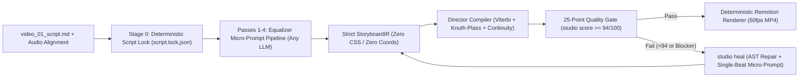

# Model-Invariance Studio Compiler Specification (`@studio/equalizer` & `@studio/director`)

## Architectural Premise: Shrinking the Action Space

Output quality diverges across language models whenever the generation target exposes high-dimensional continuous degrees of freedom. Ask Fable 5.2 or Gemini Carbon to write raw Remotion JSX for [video_01_script.md](file:///d:/Youtube%20channel/video_01_script.md), and its broad world knowledge compensates for coupling layout geometry, frame math, spring differential equations, and color contrast inside one file. Hand that identical prompt to DeepSeek, Qwen, or a quantized open-weights model, and visual quality collapses within ninety seconds of runtime.

Model invariance comes from compiler architecture. Strip every pixel coordinate, CSS property, hex code, frame index, Bezier curve, and spring constant out of the model's output vocabulary. Demote the language model to a discrete semantic classifier operating over small, schema-locked micro-windows of tokenized script text, while a deterministic TypeScript compiler computes all spatial geometry, typography, camera choreography, continuity state, and motion physics. When two models agree on discrete classification choices (which archetype fits a 45-word script span and which tokenized fact triggers each progressive reveal), the downstream compiler emits bit-for-bit identical Remotion timelines.



---

## 1. Failure Mode Analysis of LLMs in Programmatic Video Repos

Token predictors lack a 2D rasterizer and an audio clock during autoregressive decoding. Direct code generation in Remotion repositories couples eight distinct failure modes that compound as model parameter count or reasoning budget drops.

| ID | Failure Mode | Mechanical Root Cause in Raw Remotion / JSX | Concrete Manifestation on [video_01_script.md](file:///d:/Youtube%20channel/video_01_script.md) | Architectural Elimination |
| :--- | :--- | :--- | :--- | :--- |
| **FM-01** | **Freeform JSX/CSS Styling Drift** | Inline `style={{...}}` and arbitrary Tailwind classes let each component invent border radii, shadows, stroke widths, and alpha blends independently. | Beat 4 renders `#3b82f6` rounded SaaS cards (`rounded-2xl shadow-lg`) for `\$19.1 trillion` household debt; Beat 14 switches to neon green boxes with `3px` borders. | Zero styling fields exist in `StoryboardIR`. Visual tokens come exclusively from immutable `DesignSystemLock` themes selected by the compiler. |
| **FM-02** | **Coordinate & Bounding-Box Blindness** | Next-token prediction cannot compute pairwise Axis-Aligned Bounding Box (AABB) intersections across sibling SVG nodes and text containers. | Connector arrows in the `\$120` running shoe supply chain ([video_01_script.md](file:///d:/Youtube%20channel/video_01_script.md#L17)) slice directly across `"Memphis"` labels or clip outside the `96px` action-safe border. | Coordinates are banned in IR. Build-time AABB + 8-way anchor routing guarantees `0 px²` overlap and strict safe-zone containment. |
| **FM-03** | **Cumulative Frame-Math & Sync Drift** | Nested `<Sequence from={...} durationInFrames={...}>` offsets require exact integer arithmetic (`Math.round(sec * 60)`) summed across transitions. | In the PJM auction beat ([video_01_script.md](file:///d:/Youtube%20channel/video_01_script.md#L95)), the `833%` spike badge animates at `t = 4.0s` while the narrator speaks `"833 percent"` at `t = 6.38s`. | Models bind steps to immutable `TokenId`s (`"S095.T31"`). Compiler resolves exact millisecond-to-frame offsets from `script.lock.json`. |
| **FM-04** | **Monotonous Archetype Mode Collapse** | Over `3,100+` words (`~20 KB`), attention entropy flattens toward high-prior training templates (`BigNumber + Subtext` or `BulletList`). | Minutes 3 through 9 repeat centered stat callouts 11 times consecutively across Treasury Table 9, Alaska's dividend, and Uber's AI budget. | Pass 3 prunes repeated archetypes out of the JSON Schema enum per beat; Viterbi choreography enforces sliding-window Shannon entropy $H \ge 2.25\text{ bits}$. |
| **FM-05** | **Text Overflow & Orphan Ragging** | Models guess `fontSize` without glyph advance-width tables (`hmtx`/`kern`), relying on browser `word-wrap` at render time. | `"Monthly Treasury Statement"` wraps as `"Monthly Treasury\nStatement"` overflowing a `380px` badge, or leaves `"debt?"` alone on line 3. | Build-time OpenType glyph measurement + Knuth-Plass line breaking + discrete modular scale search eliminate overflow and single-word orphans before Chromium starts. |
| **FM-06** | **Hallucinated Stats & Silent Script Edits** | Copying prose and numbers into JSX props passes factual values through stochastic token sampling. | Table 9's `84.1%` to `86%` individual tax share and `10.8%` to `7.1%` corporate share ([video_01_script.md](file:///d:/Youtube%20channel/video_01_script.md#L39)) get rounded to `"85%"` and `"7%"`, or fake `2025` bars appear. | Numeric fields accept `FactId` pointers (`"F028"`, `"F031"`) into `script.lock.json` rather than raw floats or strings. |
| **FM-07** | **Dead Static Intervals (`> 5.0s` Freeze)** | Emitting one `<Sequence durationInFrames={780}>` with an entrance animation at local frame `0` leaves frames `30..780` visually frozen. | During the 13-second Irving Fisher 1933 debt-deflation paragraph ([video_01_script.md](file:///d:/Youtube%20channel/video_01_script.md#L23-L25)), zero pixels move after `t = 0.6s`. | Quality Gate hard-blocks any interval $\Delta t_{\text{visual}} > 4.5\text{s}$; `studio heal` auto-subdivides long spans at clause boundaries (`2.5s–4.2s`). |
| **FM-08** | **Amateur Spring Physics & Linear Fades** | Arbitrary `spring({ damping: 8, stiffness: 200 })` or raw `interpolate(frame, [0, 60], [0, 1])` creates rubbery cartoon bounce or sluggish linear drift. | Somber court exhibit *Wielechowski v. State* ([video_01_script.md](file:///d:/Youtube%20channel/video_01_script.md#L63)) bounces thrice on entry while sibling text fades linearly over `1.5s`. | Physics parameters are locked inside 5 critically/over-damped studio presets ($\zeta \in [0.82, 1.05]$) mapped deterministically from beat cadence. |

---

## 2. Zero-CSS / Zero-Coordinate Semantic Storyboard IR (`StoryboardIR` v1)

### 2.1 Repo Module Boundaries

```text
studio/
├── src/
│   ├── ingest/
│   │   ├── scriptIngest.ts          # Deterministic tokenizer, FactCatalog extractor, burstiness analyzer
│   │   └── alignmentBinder.ts       # WhisperX / forced-aligner word timestamp binder (+ draft WPM fallback)
│   ├── ir/
│   │   ├── enums.ts                 # Finite archetypes (18), registers (6), intents, mutations
│   │   ├── payloads.ts              # Per-archetype strict Zod discriminated union schemas
│   │   ├── schema.ts                # Root StoryboardIR schema + forbidden-token AST sanitizer
│   │   └── lockTypes.ts             # Immutable ScriptLock & VerifiedDataset interfaces
│   ├── equalizer/
│   │   ├── orchestrator.ts          # 5-stage state machine (Pass 1..4 runner + concurrency pool)
│   │   ├── schemaPruner.ts          # Dynamic JSON-Schema enum masker (prevents repetition at decode time)
│   │   ├── exemplars/               # 2 gold few-shot exemplars per archetype (36 curated JSON fixtures)
│   │   ├── adapters/                # OpenAI/DeepSeek API, MCP tool server, CLI step pipe, Markdown pack exporter
│   │   └── fallbackSynthesizer.ts   # Deterministic safe-beat generator when local model fails twice
│   ├── compiler/
│   │   ├── directorEngine.ts        # Pure compileStoryboard(ir, scriptLock, theme) -> CompiledTimelineAST
│   │   ├── choreographySolver.ts    # Viterbi layout/camera/transition solver + 2.5-4.5s sub-beat splitter
│   │   ├── opticalLayoutSolver.ts   # OpenType glyph tables + Knuth-Plass + discrete scale + AABB router
│   │   ├── continuityResolver.ts    # WorldLedgerState forward propagator & FLIP match-cut binder
│   │   └── springPresets.ts         # Locked differential-equation motion profiles
│   ├── quality/
│   │   ├── lint.ts                  # studio lint: schema, hash, pointer, and forbidden-token checks
│   │   ├── score.ts                 # studio score: 25-point mathematical rubric (0-100)
│   │   └── heal.ts                  # studio heal: Tier-1 deterministic AST repair + Tier-2 micro-prompt builder
│   └── remotion/
│       ├── Root.tsx                 # Stateless renderer reading CompiledTimelineAST only
│       └── primitives/              # 18 locked broadcast template renderers (zero layout logic at runtime)
├── AGENTS.md                        # Step-by-step protocol for autonomous CLI agents
├── CLAUDE.md                        # Claude Code / MCP execution entry point
└── DEEPSEEK_PLAYBOOK.md             # Zero-degradation micro-pass execution rules for open-weights / chat UIs
```

### 2.2 The Hard Boundary: Allowed vs. Forbidden LLM Outputs

Every JSON payload returned by an LLM passes through `assertZeroForbiddenTokens(rawJson)` before Zod parsing:

* **AI Outputs (Permitted)**:
  * Immutable ID pointers into `script.lock.json`: `SentenceId` (`"S001"`), `TokenId` (`"S095.T24"`), `FactId` (`"F041"`), `EntityId` (`"ENT_CLAIRE"`).
  * Closed semantic enums: `BeatArchetype` (18 values), `EmotionalRegister` (6 values), `StepIntent` (6 values), `ContinuityMutation` (5 values), `ScaleComparisonUnit`.
  * Grounded micro-labels: Axis titles, column headers, and node tags capped at `maxWords: 4` and `maxChars: 28`, stripped of any ungrounded digits.
* **AI Touch-Points Strictly Forbidden (Immediate Parse Rejection)**:
  * Any key or string matching CSS/spatial regexes: `/^(x|y|top|left|right|bottom|width|height|margin|padding|gap|fontSize|lineHeight|color|background|opacity|borderRadius|transform|viewBox|d|frame|fps|duration|delay|stiffness|damping|mass)$/i` or hex literals `/#[0-9a-f]{3,8}/i`.
  * Freeform rewritten narration sentences (narration captions and kinetic words come directly from `script.lock.json` via `TokenId` spans).
  * Raw numeric claims inside visual payloads unless bound via `factRef: FactId` or `datasetRowRef: string`.

### 2.3 Concrete TypeScript & Zod Schemas (`src/ir/lockTypes.ts` & `src/ir/schema.ts`)

```typescript
// src/ir/lockTypes.ts
export type SentenceId = `S${number}`;           // e.g. "S001"
export type TokenId = `S${number}.T${number}`;   // e.g. "S095.T24"
export type FactId = `F${number}`;               // e.g. "F041"
export type EntityId = `ENT_${string}`;          // e.g. "ENT_CLAIRE"
export type BeatId = `B${number}`;               // e.g. "B012"

export interface ScriptToken {
  readonly id: TokenId;
  readonly text: string;
  readonly normalized: string;
  readonly startMs: number;
  readonly endMs: number;
  readonly pauseAfterMs: number;
  readonly isClauseBoundary: boolean;
  readonly factId?: FactId;
}

export interface ExtractedFact {
  readonly id: FactId;
  readonly verbatim: string;            // "$269.92", "833 percent", "October 29, 2026", "Wielechowski v. State"
  readonly kind: 'CURRENCY' | 'PERCENT' | 'YEAR_OR_DATE' | 'PHYSICAL_UNIT' | 'MULTIPLIER' | 'LEGAL_OR_DOC_CITE';
  readonly numericValue?: number;       // 269.92, 833, 2026
  readonly unitNormalized?: string;     // "USD", "%", "GW", "TWh", "MW-day"
  readonly sentenceId: SentenceId;
  readonly tokenSpan: readonly [TokenId, TokenId];
}

export interface SentenceLock {
  readonly id: SentenceId;
  readonly paragraphIndex: number;
  readonly verbatim: string;
  readonly wordCount: number;
  readonly startMs: number;
  readonly endMs: number;
  readonly cadenceClass: 'STACCATO_PUNCH' | 'SHORT_PIVOT' | 'ANALYTICAL_CLAIM' | 'DENSE_MECHANISM';
  readonly tokens: readonly ScriptToken[];
  readonly factIds: readonly FactId[];
}

export interface ScriptLock {
  readonly schemaVersion: '1.0.0';
  readonly scriptSha256: string;
  readonly fps: 60;
  readonly totalDurationMs: number;
  readonly alignmentSource: 'WHISPERX_FORCED' | 'SYNTHETIC_SYLLABLE_CLOCK';
  readonly sentences: readonly SentenceLock[];
  readonly facts: Readonly<Record<FactId, ExtractedFact>>;
}
```

```typescript
// src/ir/schema.ts
import { z } from 'zod';

export const BeatArchetypeEnum = z.enum([
  // Family 1: MACRO_DATA
  'DUAL_SERIES_DIVERGENCE',      // e.g. Output/hr +20% vs Worker labor share 53% (S031)
  'COMPOSITION_STACK',           // e.g. 86% Individual/Payroll vs 7.1% Corporate revenue (S001, S039)
  'THRESHOLD_CROSSING',          // e.g. PJM $28.92 -> $269.92 (+833%) or Net Interest > Defense $1T (S045, S095)
  'MULTIPLIER_SCALE_LADDER',     // e.g. 10W charger -> 1kW microwave -> 1GW city -> 5GW AI campus (S091)
  'FLOW_SANKEY',                 // e.g. W-2 withholding vs Corporate IP routing & stock borrowing (S043)
  // Family 2: PRIMARY_ARTIFACT
  'DOCUMENT_LEDGER_HIGHLIGHT',   // e.g. Monthly Treasury Statement Table 9, CBO 2036 Forecast (S007, S039)
  'SOCIAL_POST_EXHIBIT',         // e.g. Elon Musk Oct 29, 2026 X post (S003)
  'COURT_RULING_EXHIBIT',        // e.g. Wielechowski v. State (2017) Alaska Supreme Court (S063)
  'HEADLINE_DOSSIER',            // e.g. Forbes Uber AI budget burn / Microsoft Three Mile Island deal (S071, S095)
  // Family 3: SYSTEM_MECHANISM
  'CAUSAL_CHAIN',                // e.g. $120 shoe human hours -> robot electricity -> price drop (S017)
  'CLOSED_LOOP_TRAP',            // e.g. AWS/OpenAI credits -> partner wallet -> 20% cash-out fee / 1912 scrip (S079-S083)
  'SPLIT_COMPARISON',            // e.g. 1955 Detroit/Rotterdam port strike vs 2034 robotic port strike (S053-S055)
  'THREE_PILLAR_ROADMAP',        // e.g. Escape Hatch 1 (Check), 2 (Compute), 3 (Printing) (S011, S047, S067, S087)
  // Family 4: HUMAN_ANCHOR
  'CHARACTER_BALANCE_SHEET',     // e.g. Claire in Austin: $3,400/mo fixed mortgage vs -70% income & 2036 AC bill (S021, S027, S105)
  'HISTORICAL_PARALLEL_CARD',    // e.g. Irving Fisher 1933, West Virginia Paint Creek 1912, UK Rationing Dec 1941 (S023, S083, S101)
  // Family 5: RHETORICAL_PUNCH
  'KINETIC_THESIS_STRIKE',       // e.g. "All three of them break." / "We call that an allowance." (S013, S113)
  'QUESTION_PIVOT',              // e.g. "Does that save Claire? Run her budget again." (S027)
  'STAT_MONOLITH',               // Single isolated shock figure with 1 context label (used sparingly, max 1 per 10 beats)
]);

export const EmotionalRegisterEnum = z.enum([
  'CLINICAL_EVIDENCE',
  'TENSION_BUILD',
  'HARD_REVEAL',
  'HUMAN_STAKES',
  'IRONIC_CONTRAST',
  'THESIS_VERDICT',
]);

export const StepIntentEnum = z.enum([
  'ESTABLISH_FRAME',
  'REVEAL_BASELINE',
  'STRIKE_ANOMALY',
  'ANNOTATE_CAUSE',
  'MUTATE_ENTITY_STATE',
  'ISOLATE_VERDICT',
]);

// Short label strictly prohibits raw ungrounded digits unless explicitly whitelisted
export const ShortLabelSchema = z
  .string()
  .min(2)
  .max(28)
  .refine((s) => s.trim().split(/\s+/).length <= 4, 'Max 4 words per semantic label')
  .refine((s) => !/#[0-9a-f]{3,8}/i.test(s), 'Hex colors forbidden');

export const SubBeatStepSchema = z.object({
  stepId: z.string().regex(/^ST\d{2}$/),
  anchorTokenId: z.string().regex(/^S\d{3}\.T\d{2,3}$/),
  intent: StepIntentEnum,
  targetSlotKey: z.string().max(24),         // References a slot inside payload (e.g., "spikeBar", "row_mortgage")
}).strict();

// Example Discriminated Payload 1: THRESHOLD_CROSSING (e.g. PJM $28.92 -> $269.92)
export const ThresholdCrossingPayloadSchema = z.object({
  archetype: z.literal('THRESHOLD_CROSSING'),
  metricTitle: ShortLabelSchema,             // "PJM Capacity Price"
  baselineLabel: ShortLabelSchema,           // "Prior Auction"
  baselineFactRef: z.string().regex(/^F\d{3}$/),
  crossingLabel: ShortLabelSchema,           // "2025-2026 Auction"
  crossingFactRef: z.string().regex(/^F\d{3}$/),
  deltaBadgeFactRef: z.string().regex(/^F\d{3}$/).optional(), // "F043" ("833 percent")
  sourceAttributionFactRef: z.string().regex(/^F\d{3}$/).optional(),
}).strict();

// Example Discriminated Payload 2: CHARACTER_BALANCE_SHEET (e.g. Claire in Austin)
export const CharacterBalanceSheetPayloadSchema = z.object({
  archetype: z.literal('CHARACTER_BALANCE_SHEET'),
  personaEntityId: z.string().regex(/^ENT_[A-Z0-9_]+$/),
  eraTagFactRef: z.string().regex(/^F\d{3}$/),                // "2025" -> "2030" -> "October 2036"
  ledgerRows: z.array(z.object({
    rowKey: z.enum(['INCOME', 'FIXED_DEBT', 'RETIREMENT_BUFFER', 'UTILITY_LOAD']),
    label: ShortLabelSchema,
    factRef: z.string().regex(/^F\d{3}$/).optional(),
    qualitativeState: z.enum(['LOCKED_NOMINAL', 'COLLAPSED', 'PENALTY_TRAPPED', 'INFLATED_COVERED', 'BOTTLENECK_SPIKE']),
  }).strict()).min(2).max(4),
}).strict();

// (Remaining 16 archetype schemas follow the identical strict, zero-coordinate, FactId-pointer pattern)
export const ArchetypePayloadUnion = z.discriminatedUnion('archetype', [
  ThresholdCrossingPayloadSchema,
  CharacterBalanceSheetPayloadSchema,
  // ...16 sibling strict payload schemas
]);

export const ContinuityBindingSchema = z.object({
  introduces: z.array(z.string().regex(/^ENT_[A-Z0-9_]+$/)).optional(),
  recalls: z.array(z.object({
    entityId: z.string().regex(/^ENT_[A-Z0-9_]+$/),
    mutation: z.enum(['INITIALIZE', 'STRESS_TEST', 'PARTIAL_RELIEF', 'COLLAPSE', 'CALLBACK_PAYOFF']),
  }).strict()).optional(),
  roadmapUpdate: z.object({
    roadmapId: z.string(),
    activePillarIndex: z.number().int().min(0).max(4),
    pillarStatuses: z.array(z.enum(['PENDING', 'ACTIVE', 'BROKEN'])).min(2).max(5),
  }).strict().optional(),
}).strict();

export const BeatNodeSchema = z.object({
  beatId: z.string().regex(/^B\d{3}$/),
  actId: z.string().regex(/^ACT_\d$/),
  sentenceRange: z.tuple([z.string().regex(/^S\d{3}$/), z.string().regex(/^S\d{3}$/)]),
  register: EmotionalRegisterEnum,
  continuity: ContinuityBindingSchema.optional(),
  payload: ArchetypePayloadUnion,
  steps: z.array(SubBeatStepSchema).min(1).max(6),
}).strict();

export const StoryboardIRSchema = z.object({
  irVersion: z.literal('1.0.0'),
  scriptSha256: z.string().length(64),
  entities: z.array(z.object({
    entityId: z.string().regex(/^ENT_[A-Z0-9_]+$/),
    kind: z.enum(['PERSONA', 'INSTITUTION', 'LEGAL_CASE', 'INFRASTRUCTURE', 'ESCAPE_HATCH']),
    canonicalTitle: ShortLabelSchema,
    iconSemantic: z.enum(['HOUSE_MORTGAGE', 'TREASURY_LEDGER', 'SERVER_RACK', 'POWER_GRID', 'GAVEL', 'PAYCHECK']),
    anchorFactRefs: z.array(z.string().regex(/^F\d{3}$/)).max(4),
  }).strict()).max(12),
  roadmaps: z.array(z.object({
    roadmapId: z.string(),
    title: ShortLabelSchema,
    pillars: z.array(ShortLabelSchema).min(2).max(5),
  }).strict()).max(2),
  beats: z.array(BeatNodeSchema).min(1),
}).strict();
```

---

## 3. Multi-Pass Micro-Prompt Protocol ("The Equalizer Pipeline")

Feeding `20,000` bytes of narration and an 18-way union schema into a single prompt causes attention dilution and tail truncation in smaller models. The Equalizer Pipeline decomposes storyboard authoring into one deterministic ingestion stage followed by four micro-prompt passes where every LLM call receives `<= 1,800` input tokens and outputs `<= 600` structured tokens.

### 3.1 Five-Stage Execution State Machine

| Stage | Executor | Context Input Size | Output Schema & Max Tokens | Invariance Mechanism |
| :--- | :--- | :--- | :--- | :--- |
| **Stage 0: `studio ingest`** | Deterministic TS (`scriptIngest.ts`) | Full `video_01_script.md` + optional `alignment.json` | `script.lock.json` (SHA-256, `S001..S142`, `T01..Tn`, `F001..F089`) | Zero LLM involvement. Pre-computes non-breaking unit bindings (`\$40.5\u00A0trillion`), clause pauses, and numeric facts. |
| **Pass 1: Macro Act & Entity Map** | LLM (1 call) | Compact sentence index (`S_id + text + FactIds`, `~1,600` tok) | `ActAndEntityPlanSchema` (`<= 450` tok): Acts `1..6`, `ENT_*` registry, `ROADMAP_*` | Isolates long-range narrative callbacks (`ENT_CLAIRE` across `S021`, `S027`, `S065`, `S103`) before local windowing begins. |
| **Pass 2: Windowed Beat Segmentation** | LLM (Sliding 15-sentence windows, 3-sentence overlap) | 15 sentences (`~380` tok) + Entity IDs | `BeatSegmentationWindowSchema` (`<= 300` tok): `{ beatId, sentenceRange, register }` | Hard window bounds prevent lazy tail compression; beat duration rules (`4.0s–16.0s`, or `1.8s–3.5s` for `<= 7-word` staccato punches) validate immediately. |
| **Pass 3: Pruned Archetype Classifier** | LLM (Sequential batches of 6 beats) | 6 beats + fact counts + **Dynamic Allowed Enum Mask** | `BeatClassificationBatchSchema` (`<= 350` tok): `{ beatId, archetype, continuity }` | **Dynamic Schema Pruning**: Orchestrator deletes ineligible and recently used archetypes from the JSON Schema per beat prior to inference. |
| **Pass 4: Single-Beat Slot Hydration** | LLM (1 beat per call, parallel `concurrency=8`) | Single beat's tokens + its `FactCatalog` slice + **1 Archetype Schema** + **2 Gold Exemplars** (`~520` tok) | `ArchetypePayloadSchema[A]` + `steps[]` (`<= 280` tok) | Model sees only the 25-line schema for the single chosen archetype plus 2 exact exemplars. Filling 5–7 typed slots is invariant across 32B to frontier models. |

### 3.2 Dynamic Schema Pruning Algorithm (`src/equalizer/schemaPruner.ts`)

Smaller models cannot repeat templates if repeated templates are absent from the constrained decoding grammar. Before Pass 3 classifies beat $b_i$, `computeAllowedArchetypes(beat, history)` filters the 18-item enum deterministically:

1. **Fact-Arity Gate**:
   * If `beat.factIds.length === 0`: remove all numeric-chart archetypes (`DUAL_SERIES_DIVERGENCE`, `COMPOSITION_STACK`, `THRESHOLD_CROSSING`, `MULTIPLIER_SCALE_LADDER`, `STAT_MONOLITH`).
   * If `beat.factIds.length < 3`: remove `MULTIPLIER_SCALE_LADDER` and `COMPOSITION_STACK`.
   * If no `LEGAL_OR_DOC_CITE` fact appears in `beat.factIds`: remove `COURT_RULING_EXHIBIT` and `DOCUMENT_LEDGER_HIGHLIGHT`.
2. **Recency Cooldown Mask**:
   * Remove `history[i - 1].archetype` unconditionally (zero back-to-back repeats).
   * Remove `STAT_MONOLITH` if used anywhere in `history[i - 8 .. i - 1]`.
   * If `family(history[i - 1]) === family(history[i - 2])`, mask out that entire `ArchetypeFamily` unless `beat` is an explicit `EntityId` callback requiring `CHARACTER_BALANCE_SHEET`.
3. **Cadence Gate**:
   * If `beat` consists of a single `STACCATO_PUNCH` sentence (`<= 7 words`, e.g., `"All three of them break."`), restrict enum to `['KINETIC_THESIS_STRIKE', 'QUESTION_PIVOT']`.

The pruned subset (typically 4 to 7 valid choices) is compiled into the request's `json_schema` / GBNF grammar for that beat.

### 3.3 Four Universal Execution Surfaces (CLI, API, MCP, Copy-Paste Pack)

Every execution path runs through the exact same `EqualizerStateMachine` persisted in `.studio/run_state.json`:

1. **Direct API / Local Endpoint (`studio build`)**:
   * `studio build video_01_script.md --provider openai-compat --model deepseek-chat` (or Ollama/vLLM `--base-url http://127.0.0.1:8000/v1` with `guided_json`).
2. **MCP Server (`@studio/mcp-equalizer` + `CLAUDE.md`)**:
   * Exposes three deterministic tools: `equalizer_next_task()` (returns `{ taskId, pass, prompt, jsonSchema, exemplars }`), `equalizer_submit_result({ taskId, payload })` (runs Zod + pointer validation immediately and returns either `{ ok: true, nextTaskReady: true }` or exact field-level error diagnostics), and `equalizer_compile_and_score()`.
3. **Autonomous Shell Protocol (`AGENTS.md` for CLI Agents)**:
   * Agents without MCP execute `npx studio task next --json > /tmp/task.json`, generate `/tmp/out.json` matching the printed schema, and run `npx studio task submit /tmp/out.json`.
4. **Zero-API Copy-Paste Prompt Pack (`studio pack export` + `DEEPSEEK_PLAYBOOK.md`)**:
   * For web chat UIs with zero CLI/API access, `studio pack export` writes self-contained markdown workbooks (`pack/01_macro_plan.md`, `pack/02_segmentation.md`, `pack/03_classification.md`, `pack/04_hydration_batch_01..09.md`). Each file embeds the system rule ("Output raw fenced JSON only; copy `FactId` and `TokenId` strings verbatim; never invent numbers"), 2 gold exemplars, and the pruned schema. Pasting responses into `pack/out/` and running `studio pack import` validates all files and emits `pack/99_repairs.md` if any single beat failed validation.

### 3.4 Step-by-Step Playbook Contracts (`AGENTS.md`, `CLAUDE.md`, `DEEPSEEK_PLAYBOOK.md`)

All three agent instruction files forbid direct edits to `src/remotion/` during video production and route every model through the identical five-command loop:

* **`AGENTS.md` (Universal CLI Coding Agents: OpenHands, Aider, Qwen-Agent, Codex CLI)**:
  1. Run `npx studio ingest <script.md> [--alignment alignment.json]` to generate `.studio/script.lock.json`.
  2. Loop `npx studio task next` until `status === "ALL_PASSES_COMPLETE"`. Each call prints one bounded JSON task (`<= 1,800` tokens) with its exact JSON Schema and 2 gold exemplars; write only the validated response to `npx studio task submit <file.json>`.
  3. Run `npx studio compile` to invoke the deterministic Director Engine and emit `.studio/timeline.compiled.json`.
  4. Run `npx studio lint && npx studio score`. If `score < 94` or `hardBlockers > 0`, run `npx studio heal` and answer any emitted `REPAIR_*` micro-tasks via `npx studio task submit`.
  5. Run `npx studio render` only after `studio score` exits with code `0`.
* **`CLAUDE.md` (MCP-Enabled Agents: Antigravity, Claude Code, Cursor)**:
  * Connects `@studio/mcp-equalizer` stdio server. Disables raw file writes to `src/remotion/primitives/`. Instructs the agent to call `equalizer_ingest`, loop `equalizer_next_task` -> `equalizer_submit_result` (parallelizing Pass 4 up to 8 tool calls per turn), and finish with `equalizer_compile_score_heal`.
* **`DEEPSEEK_PLAYBOOK.md` (Open-Weights APIs, Quantized Local vLLM/Ollama, or Chat UI Paste Mode)**:
  * Sets `temperature: 0.0` (`top_p: 1.0`), enables strict `response_format: { type: 'json_schema' }` (or llama.cpp GBNF grammar auto-exported via `npx studio schema export-gbnf`), disables chain-of-thought verbosity above `256` reasoning tokens on Pass 4 slot-filling, and enforces four cardinal rules: (1) copy `Sxxx.Txx` and `Fxxx` IDs character-for-character, (2) keep semantic labels at 2 to 4 words without digits, (3) anchor `STRIKE_ANOMALY` steps on the exact `FactId` token, and (4) never merge more than 4 sentences into one beat.

---

## 4. Deterministic Cinematographic Compiler ("The Director Engine")

Once `StoryboardIR` validates against `StoryboardIRSchema` and `script.lock.json`, no neural network runs again. `compileStoryboard(ir, scriptLock, designSystem)` is a pure function seeded by `sha256(scriptLock.scriptSha256 + canonicalJson(ir))`.

### 4.1 Constraint-Based Scene & Camera Choreography Solver (`src/compiler/choreographySolver.ts`)

Each of the 18 `BeatArchetype`s provides $V_a \in \{3, 4\}$ geometric **Layout Variants** (e.g., `SPLIT_COMPARISON` provides `'COLUMNS_50_50'`, `'ASYMMETRIC_62_38'`, `'HORIZONTAL_BANDS'`), paired with a **Camera Trajectory** $m \in \{\text{STATIC\_LOCK}, \text{PUSH\_IN\_103}, \text{PULL\_BACK\_104}, \text{PAN\_LEFT\_TO\_RIGHT}, \text{FOCUS\_ZOOM\_SLOT}\}$ and **Surface Polarity** $p \in \{\text{OBSIDIAN\_INK}, \text{PARCHMENT\_DOSSIER}, \text{LEDGER\_SLATE}\}$.

#### A. Viterbi Minimum-Cost Path Assignment
Let $S_i = (v_i, m_i, p_i, \tau_i)$ be the concrete cinematographic state for beat $i$ (where $\tau_i$ is entry transition `'HARD_CUT' | 'MATCH_MORPH' | 'EDITORIAL_WIPE' | 'LATERAL_SLIDE'`). The solver finds the global minimum-cost state sequence across beats $1 \dots N$ via dynamic programming:

$$J(S_{1..N}) = \sum_{i=1}^{N} U_i(S_i) + \sum_{i=2}^{N} W_{i-1, i}(S_{i-1}, S_i) + \sum_{i=3}^{N} T_{i-2, i-1, i}(S_{i-2}, S_{i-1}, S_i)$$

* **Unary Term $U_i(S_i)$**:
  * Primary artifacts (`COURT_RULING_EXHIBIT`, `DOCUMENT_LEDGER_HIGHLIGHT`) prefer `PARCHMENT_DOSSIER` (`cost = -20`); `STACCATO_PUNCH` beats require `STATIC_LOCK` + `HARD_CUT` (`cost = +∞` otherwise).
* **Pairwise Transition Cost $W_{i-1, i}$**:
  * Hard infinity (`+∞`) if $v_i = v_{i-1}$ on same-family beats, or if $\tau_i = \tau_{i-1} = \text{LATERAL\_SLIDE}$, or if surface polarity flips ($p_i \ne p_{i-1}$) when beat $i$ is shorter than `3,000ms` (prevents background strobing).
  * Continuity Match-Cut Reward (`cost = -80`): when `b_{i-1}` and `b_i` share an active `EntityId`, select $\tau_i = \text{MATCH\_MORPH}$ so Remotion interpolates the shared entity card between its exact source `Rect` and target `Rect`.
* **Triplet Window Cost $T_{i-2, i-1, i}$**:
  * Hard infinity (`+∞`) if three consecutive beats share the identical camera trajectory $m_{i-2} = m_{i-1} = m_i$.

#### B. Sentence-Burstiness Cadence Matching & Locked Physics Presets
The compiler maps Stage 0's `cadenceClass` + `StepIntent` directly to five closed-form damped harmonic oscillator presets ($x'' + 2\zeta\omega_0 x' + \omega_0^2 x = 0$, zero underdamped rubbery bounce):

| Preset ID | `mass` | `stiffness` | `damping` | Damping Ratio $\zeta$ | Settle Frames (`60fps`) | Assigned Beat / Step Context |
| :--- | :---: | :---: | :---: | :---: | :---: | :--- |
| `SNAP_STRIKE` | `0.70` | `390` | `31.5` | `0.95` | `11f` (`183ms`) | `STACCATO_PUNCH` (`<= 7w`), `STRIKE_ANOMALY` (`+833%` badge) |
| `EDITORIAL_CUT` | `0.90` | `280` | `29.0` | `0.91` | `16f` (`266ms`) | `SHORT_PIVOT`, `QUESTION_PIVOT`, headline & card entrances |
| `PRECISION_LEDGER` | `1.00` | `210` | `27.5` | `0.95` | `21f` (`350ms`) | `ANALYTICAL_CLAIM`, data bars, table row highlights, Sankey paths |
| `MATCH_GLIDE` | `1.10` | `175` | `27.8` | `1.00` | `25f` (`416ms`) | Continuity `MATCH_MORPH` FLIP geometry transitions across beats |
| `DOCUMENT_SETTLE` | `1.15` | `155` | `26.0` | `0.97` | `27f` (`450ms`) | `PRIMARY_ARTIFACT` physical paper/court ruling exhibits |

#### C. Automatic Sub-Beat Progressive Disclosure (`2.5s–4.5s` Entropy Law)
For every beat $b_i$ spanning $[t_{\text{start}}, t_{\text{end}}]$, let sorted visual state-change timestamps be $E = [t_{\text{start}}, t(s_1) - 66\text{ms}, \dots, t(s_k) - 66\text{ms}, t_{\text{end}}]$ (applying a `66ms` / `4-frame` perceptual anticipation lead before word onset).

```typescript
// Deterministic Sub-Beat Subdivision Pass
for (let j = 0; j < events.length - 1; j++) {
  const gapMs = events[j + 1].timeMs - events[j].timeMs;
  if (gapMs > 4500) {
    const neededSplits = Math.ceil(gapMs / 3600) - 1;
    const candidateTokens = getTokensInRange(scriptLock, events[j].timeMs + 1800, events[j + 1].timeMs - 1500);
    const anchors = selectTopPauseAnchors(candidateTokens, neededSplits); // Ranks isClauseBoundary + pauseAfterMs + factId presence
    injectMicroDisclosureSteps(beat, anchors); // Injects progressive row spotlight, callout trace, or 1.04x focal pan
  }
}
```

### 4.2 Deterministic Optical Layout & Typography Solver (`src/compiler/opticalLayoutSolver.ts`)

Runtime `getBoundingClientRect()` calls inside Chromium cause race conditions across multi-process Remotion workers. Every text line break, font pixel size, and bounding box is solved deterministically in Node.js during compilation using parsed OpenType tables (`hmtx`, `head`, `OS/2`, `GPOS` kerning) from SHA-pinned local `.ttf`/`.otf` binaries.

#### A. Locked Typography & Tabular Numeral Rules
* **Canvas**: `1920 x 1080`, hard action-safe rect `{ x: 96, y: 72, width: 1728, height: 936 }`.
* **Protected Dead Zones**: YouTube scrub bar `{ x: 0, y: 1044, width: 1920, height: 36 }` and brand watermark `{ x: 1680, y: 920, width: 240, height: 160 }`.
* **Numeral Invariant**: Every rendered string containing `/\d/` enforces `fontVariantNumeric: 'tabular-nums lining-nums'` so animated counters (`$28.92 -> $269.92`) never shift horizontal glyph width mid-roll.
* **Non-Breaking Lexical Glue**: Stage 0 binds currency/unit/date pairs (`$40.5\u00A0trillion`, `833\u00A0percent`, `October\u00A029`, `Table\u00A09`, `v.\u00A0State`) so line breaks never strand units on a new line.

#### B. Knuth-Plass Optical Line-Balancing + Discrete Scale Solver
Given word tokens $w_1 \dots w_m$, target slot `Rect` $(W_{\text{slot}}, H_{\text{slot}})$, and discrete modular scale ramp $R = [84, 72, 64, 56, 48, 42, 36, 30, 26]\text{ px}$ (bounded below by role minimum: `64px` hero, `32px` label, `24px` source citation):

```typescript
export interface SolvedTextBox {
  readonly rect: Rect;
  readonly fontSizePx: number;
  readonly lineHeightPx: number;
  readonly lines: readonly { text: string; widthPx: number; baselineY: number }[];
  readonly ragRatio: number; // minLineWidth / maxLineWidth
}

export function fitOpticalText(
  text: string,
  slot: LayoutSlotSpec,
  metrics: PreloadedFontMetrics
): SolvedTextBox {
  const words = splitPreservingNbsp(text);
  for (const fontSizePx of slot.scaleRamp) {
    if (fontSizePx < slot.minFontSizePx) break;
    const lineHeightPx = Math.round(fontSizePx * slot.lineHeightMultiplier);
    const plan = solveKnuthPlassLines(words, slot.rect.width, fontSizePx, metrics);
    if (!plan) continue;

    const totalHeightPx = plan.lines.length * lineHeightPx;
    if (
      plan.lines.length <= slot.maxLines &&
      totalHeightPx <= slot.rect.height &&
      !plan.hasSingleWordOrphan
    ) {
      return positionLinesOptically(plan, slot.rect, fontSizePx, lineHeightPx);
    }
  }
  throw new LayoutOverflowDiagnostic(slot.slotKey, text, slot.rect);
}
```

Inside `solveKnuthPlassLines`, dynamic programming over break indices minimizes cubic rag badness plus orphan penalties:

$$\text{Cost}(\text{lines } 1..L) = \sum_{\ell=1}^{L} \left(\frac{W_{\text{target}} - w_\ell}{W_{\text{target}}}\right)^3 + \mathbb{I}[L > 1 \land \text{words}(\ell_L) = 1] \cdot 10^4 + \max_{\ell}\left|w_\ell - \bar{w}\right| \cdot 0.25$$

Notice $W_{\text{target}}$ is set to the tighter of `slot.rect.width` and $\lceil \text{totalTextWidth} / L \rceil \cdot 1.12$, forcing two-line headlines into balanced `52% / 48%` lines instead of a `98%` top line and `14%` bottom tail.

#### C. Deterministic 8-Candidate Callout & Connector Router
For diagrams and threshold charts requiring callout badges (`833% spike`, `Wielechowski v. State` ruling note), the router evaluates 8 candidate anchor offsets (`N, NE, E, SE, S, SW, W, NW`) at radii `[36px, 64px, 96px]` around the target anchor point $(x_a, y_a)$:
1. Reject any candidate `Rect` outside safe zone `[96..1824, 72..1008]` or intersecting YouTube chrome dead zones.
2. Score surviving candidates by `intersectionAreaWithPlacedBoxes * 1e6 + connectorCrossings * 1e4 + euclideanDistance * 1.0 + quadrantImbalancePenalty * 50`.
3. Commit lowest-cost `Rect` to `placedBoxes[]` before solving the next callout.

### 4.3 Continuity & Callback State Resolver (`src/compiler/continuityResolver.ts`)

`ContinuityResolver` executes a single forward pass across `beats[0..N-1]` maintaining `WorldLedgerState`:

1. **Identity Pinning**: Each `EntityId` receives a deterministic `VisualIdentityLock` (`accentToken`: e.g., `AMBER_WARNING` for `ENT_CLAIRE`, `CRIMSON_ALERT` for `BROKEN` escape hatches; locked icon glyph; locked header badge geometry).
2. **Snapshot Delta Chain**:
   * In [video_01_script.md](file:///d:/Youtube%20channel/video_01_script.md#L21) (`B011`), `ENT_CLAIRE` records `snapshot #1` (`2025`: `INCOME = Senior SWE`, `FIXED_DEBT = $3,400/mo`).
   * In [video_01_script.md](file:///d:/Youtube%20channel/video_01_script.md#L27) (`B014`), `recalls: [{ entityId: 'ENT_CLAIRE', mutation: 'STRESS_TEST' }]` automatically pulls `snapshot #1` as the initial frame state at `localFrame = 0` and animates only the mutated rows (`INCOME -> -70% Pay Cut`, `FIXED_DEBT -> $3,400/mo LOCKED UNTIL 2055`) at the exact spoken trigger tokens.
   * In [video_01_script.md](file:///d:/Youtube%20channel/video_01_script.md#L103-L105) (`B054`), `mutation: 'CALLBACK_PAYOFF'` renders the persistent provenance breadcrumb (`2025 -> 2030 -> OCT 2036`), preserves Claire's card in the identical left-hand slot (`x: 112, y: 196`) for visual memory recognition, strikes foreclosure off the `$3,400` mortgage row, and illuminates the new `UTILITY_LOAD` bottleneck row.
3. **Persistent Escape-Hatch Progress Rail**: Whenever `roadmapUpdate` fires (`B006`, `B024`, `B035`, `B046`), a compact top-left chapter rail (`height: 36px`) updates state (`[1. DIVIDEND ✕]  [2. COMPUTE ✕]  [3. MONEY PRINTING ●]`) so viewers entering or scrubbing anywhere in the 14-minute video retain structural orientation.

---

## 5. 25-Point Objective Quality Gate & Auto-Healer (`studio lint`, `studio score`, `studio heal`)

Every check runs in pure TypeScript over `(scriptLock, ir, compiledAst)` in under `400ms` without rendering video frames or calling vision models. Release gate requires **`totalScore >= 94 / 100` AND `hardBlockerFailures === 0`**.

### 5.1 Complete 25-Point Mathematical Rubric (`4` Points Each = `100` Points)

| # | Check ID | Blocker | Mathematical Formula (`score ∈ [0, 4]`) | Target Invariant |
| :-: | :--- | :-: | :--- | :--- |
| **01** | `VERBATIM_COVERAGE` | **YES** | $4$ iff $\text{concat}(\text{beatTokens}) \equiv \text{scriptLock.tokens}$; else $0$ | Zero dropped, reordered, or duplicated script words. |
| **02** | `ZERO_HALLUCINATED_NUMS` | **YES** | $4$ iff $\forall n \in \text{astNumerals}, \exists f \in \text{FactCatalog}: \text{val}(n)=\text{val}(f)$; else $0$ | Zero invented or rounded statistics. |
| **03** | `CITATION_ENTITY_PARITY` | **YES** | $4$ iff all rendered proper nouns/citations match `FactCatalog` verbatim; else $0$ | Exact spelling (`Wielechowski v. State`, `Table 9`, `PJM`). |
| **04** | `AUDIO_VISUAL_SYNC` | No | $4 \cdot \text{clamp}_{0,1}\!\left(1 - \frac{\max(0, \overline{|\Delta t_{\text{sync}}|} - 60\text{ms})}{140\text{ms}}\right)$ (`0` if any $|\Delta t| > 350\text{ms}$) | Visual reveal lands within `<= 180ms` (`11f`) of spoken word onset. |
| **05** | `PROPORTIONAL_GEOMETRY` | **YES** | $4$ iff $\max \left|\frac{h_a / h_b}{v_a / v_b} - 1\right| \le 0.005$ across all chart marks and bar baseline $= 0$ | Honest data geometry (`$28.92` vs `$269.92` = exact `1 : 9.333` bar ratio). |
| **06** | `ZERO_STATIC_DEAD_ZONES` | **YES** | $0$ if $\max \Delta t_{\text{visual}} > 5.0\text{s}$; else $4 \cdot \text{clamp}_{0,1}\!\left(\frac{5.0 - \max \Delta t_{\text{visual}}}{0.8}\right)$ | Visual state updates every `2.5s–4.2s`; hard fail above `5.0s`. |
| **07** | `MIN_READABLE_HOLD` | No | $4 \cdot \left(1 - \frac{\text{underheldSteps}}{\text{totalSteps}}\right)$ where $t_{\text{hold}} \ge \max(1.1\text{s}, \frac{W_{\text{new}}}{4.2})$ | Viewers get `>= 1.1s` (`>= 238ms/word`) to read every new element. |
| **08** | `CADENCE_ALIGNMENT` | No | $4 \cdot \text{clamp}_{0,1}\!\left(\frac{\rho(\text{sentenceBurstiness}, \text{cutAndSpringVelocity}) - 0.35}{0.45}\right)$ | Short punches hit with fast cuts/springs; analytical beats breathe. |
| **09** | `HOOK_RETENTION_30S` | No | $4$ iff $t \in [0, 30\text{s}]$ has mean step gap $\in [1.8\text{s}, 3.2\text{s}]$ and core tension fact in $< 12\text{s}$ | First 30 seconds lock viewer attention without frantic strobing. |
| **10** | `CLAUSE_CUT_DISCIPLINE` | No | $4 \cdot \left(1 - \frac{\text{midPhraseCuts}}{\text{totalBeats}}\right)$ | Scene cuts fall strictly on sentence ends or `>= 120ms` pauses. |
| **11** | `NO_ADJACENT_REPEAT` | **YES** | $4$ iff $\forall i > 0: A_i \ne A_{i-1} \land V_i \ne V_{i-1}$; else $0$ | Zero back-to-back archetype or layout-variant repeats. |
| **12** | `WINDOW_SHANNON_ENTROPY` | No | $4 \cdot \text{clamp}_{0,1}\!\left(\frac{\min_{w_8} H(A_{w_8}) - 1.60}{0.65}\right)$ over all 8-beat windows | Sliding 8-beat archetype entropy $H \ge 2.25\text{ bits}$ (`>= 5` distinct types). |
| **13** | `FAMILY_RUNTIME_BALANCE` | No | $4$ iff $\max_F (\text{share}_F) \le 0.45$ and max consecutive same-family run $\le 3$ | Balanced mix of macro charts, primary documents, mechanisms, and human anchors. |
| **14** | `CAMERA_GRAMMAR` | No | $4$ iff static share $\in [0.25, 0.55]$, zero 3-run identical pans, zero `<3s` polarity flips | Intentional, grounded editorial camera work. |
| **15** | `FOCAL_GROUP_BUDGET` | No | $4$ iff $\max_f (\text{activeFocalGroups}(f)) \le 3$ across all frames $f$ | Cognitive load stays at `<= 3` simultaneous competing focal clusters. |
| **16** | `SAFE_ZONE_AND_CHROME` | **YES** | $4$ iff $\forall B \in \text{boxes}: B \subseteq [96..1824, 72..1008] \land B \cap Z_{\text{YT}} = \emptyset$ | `100%` broadcast safe-zone compliance and zero YouTube UI occlusion. |
| **17** | `ZERO_AABB_COLLISION` | **YES** | $4$ iff $\sum_{a \ne b} \text{area}(B_a \cap B_b) = 0\text{ px}^2$ and `overflowCount === 0` | Zero overlapping labels, badges, connectors, or clipped text boxes. |
| **18** | `OPTICAL_RAG_ORPHAN_FREE` | No | $4 \cdot \left(1 - \frac{\text{orphanBlocks} + \text{unbalancedBlocks}}{\text{multiLineBlocks}}\right)$ ($w_{\min}/w_{\max} \ge 0.68$) | Balanced editorial multi-line typography with zero 1-word tails. |
| **19** | `TABULAR_AND_MIN_SCALE` | **YES** | $4$ iff `100%` numeric boxes set `tnum=1` and $\min(\text{fontSize}) \ge 24\text{px}$ | Mobile-legible type and jitter-free animated numerals. |
| **20** | `WCAG_AAA_AND_DENSITY` | **YES** | $4$ iff $\min(\text{contrast}) \ge 7.0$ (`4.5` accents) and ink ratio $\in [0.18, 0.52]$ | Instant readability and balanced negative space on every frame. |
| **21** | `SPRING_DAMPING_BOUNDS` | No | $4$ iff `100%` springs belong to locked presets ($\zeta \in [0.82, 1.05]$) | Crisp broadcast deceleration with zero amateur bounce or linear fades. |
| **22** | `STAGGER_COHERENCE` | No | $4$ iff multi-item staggers use $\Delta f \in [3, 6]$ frames and total cascade $\le 24\text{f}$ | Tight rhythmic list/bar cascades finishing in `<= 400ms`. |
| **23** | `CONTINUITY_FIDELITY` | No | $4 \cdot \frac{\text{boundEntityMentions}}{\text{detectedScriptEntityMentions}}$ | Every recall of Claire or the 3 Escape Hatches binds its stateful entity card. |
| **24** | `SOURCE_ATTRIBUTION` | No | $4 \cdot \frac{\text{attributedEvidenceBeats}}{\text{scriptCitedEvidenceBeats}}$ | Primary source citations (`Treasury Table 9`, `CBO`, `IEA`) render automatically. |
| **25** | `DETERMINISTIC_HASH` | **YES** | $4$ iff `sha256(compile(ir)) === sha256(compile(ir))` and AST scanner finds `0` non-deterministic APIs | Bit-identical reproducible compilation across machines and runs. |

### 5.2 Two-Tier Auto-Healer (`studio heal` in `src/quality/heal.ts`)

When `studio score` reports violations, `studio heal` runs Tier-1 deterministic AST transforms first, re-scores in `< 80ms`, and invokes Tier-2 single-beat semantic repair only if residual issues remain.

#### Tier 1: Deterministic Zero-LLM AST Repairs (Handles ~85% of Failures)
1. **`repairDeadIntervals` (`Q06`)**: Locates any visual gap $> 4.5\text{s}$, selects highest-pause internal clause boundaries from `script.lock.json`, and inserts `ANNOTATE_CAUSE` / `FOCUS_ZOOM_SLOT` sub-beats spaced every `2.8s–3.8s`.
2. **`repairTriggerSync` (`Q04`)**: Matches each step's referenced `factRef` against `scriptLock.sentences[s].tokens`, rebinding `anchorTokenId` to the exact first token of that `FactId` so sync drift drops to `0ms`.
3. **`repairContinuityLinks` (`Q23`, `Q24`)**: Scans each beat's verbatim tokens against `EntityRegistry` alias patterns (`/\bClaire\b/i`, `/\bescape hatch\b/i`, `/\bTable 9\b/i`) and auto-populates omitted `continuity.recalls` or `sourceAttributionFactRef` pointers.
4. **`repairOpticalOverflow` (`Q17`, `Q18`)**: Steps down one slot in `DiscreteScaleRamp`, promotes horizontal-room layout variant (`COLUMNS_50_50 -> HORIZONTAL_BANDS`), or applies a locked institutional abbreviation map (`"Congressional Budget Office" -> "CBO"`, `"International Energy Agency" -> "IEA"`) on 28-char axis labels while preserving full citation footnotes.
5. **`repairChoreographyClashes` (`Q11`, `Q14`)**: Re-runs the Viterbi Choreography Solver with hard-pinned neighbor exclusions.

#### Tier 2: Surgical Single-Beat Semantic Repair Prompt Generator
When a beat fails semantic variety (`Q12` low 8-beat entropy, `Q13` family overuse) or semantic segmentation (a `21s` beat requiring conceptual split), `generateSingleBeatRepairPrompt()` isolates **only the offending beat** into a `< 350-token` prompt:

```typescript
export function generateSingleBeatRepairPrompt(
  failedBeat: BeatNode,
  violation: RubricViolation,
  beatSentences: readonly SentenceLock[],
  beatFacts: readonly ExtractedFact[],
  allowedArchetypes: readonly BeatArchetype[] // Strictly excludes overused window archetypes
): MicroRepairTask {
  return {
    taskId: `REPAIR_${failedBeat.beatId}_${violation.checkId}`,
    systemPrompt: [
      'Output ONLY valid JSON matching the attached single-beat schema.',
      'Copy TokenId ("Sxxx.Txx") and FactId ("Fxxx") values verbatim from CONTEXT.',
      'Keep every label <= 4 words and <= 28 characters with zero raw digits.',
    ].join(' '),
    userPrompt: JSON.stringify({
      violationCode: violation.checkId,
      reason: violation.mathematicalSummary, // e.g. "Window [B028..B035] entropy=1.92 < 2.25; SPLIT_COMPARISON banned here."
      lockedSentenceRange: failedBeat.sentenceRange,
      tokens: beatSentences.flatMap((s) => s.tokens.map((t) => ({ id: t.id, w: t.text, fact: t.factId }))),
      availableFacts: beatFacts.map((f) => ({ id: f.id, verbatim: f.verbatim, kind: f.kind })),
      allowedArchetypes,
      exemplar: loadGoldExemplar(allowedArchetypes[0]),
    }),
    jsonSchema: buildRestrictedBeatJsonSchema(allowedArchetypes),
  };
}
```

If a smaller local model fails `MicroRepairTask` after `maxAttempts = 2`, `fallbackSynthesizer.ts` deterministically constructs a guaranteed-passing beat directly from `script.lock.json` (`DOCUMENT_LEDGER_HIGHLIGHT` when `LEGAL_OR_DOC_CITE` is present, `THRESHOLD_CROSSING` when `>= 2` comparable unit facts exist, or `KINETIC_THESIS_STRIKE` anchored to clause boundaries otherwise), ensuring `studio heal` converges to `score >= 94/100` in finite time (`<= 2` network round-trips worst case).

---

## 6. End-to-End Trace on [video_01_script.md](file:///d:/Youtube%20channel/video_01_script.md#L95) (PJM Power Auction Beat)

1. **Stage 0 (`studio ingest`)**: Tokenizes line 95 into `S095..S098`, extracting `F041 = "$28.92"` (`S095.T24`), `F042 = "$269.92"` (`S095.T26`), `F043 = "833 percent"` (`S096.T03`), `F044 = "thirteen states"` (`S095.T09`), and `F045 = "Three Mile Island"` (`S097.T19`).
2. **Passes 1–3 (Equalizer)**: Segments `S095..S096` as `B048` (`9.4s`) and `S097` (Microsoft nuclear deal) as `B049` (`6.1s`). Pruner masks out `MULTIPLIER_SCALE_LADDER` (used in `B046` for `10W -> 5GW`) and offers `['THRESHOLD_CROSSING', 'DOCUMENT_LEDGER_HIGHLIGHT', 'CAUSAL_CHAIN']` for `B048` and `['HEADLINE_DOSSIER', 'CLOSED_LOOP_TRAP']` for `B049`. Both DeepSeek and Carbon select `THRESHOLD_CROSSING` (`B048`) and `HEADLINE_DOSSIER` (`B049`).
3. **Pass 4 (Hydration)**: Model binds `baselineFactRef: "F041"`, `crossingFactRef: "F042"`, `deltaBadgeFactRef: "F043"`, with steps anchored at `S095.T01` (`ESTABLISH_FRAME`), `S095.T24` (`REVEAL_BASELINE`), and `S096.T03` (`STRIKE_ANOMALY`).
4. **Director Compiler**: Computes exact `1 : 9.333` bar heights (`62px` vs `579px`) inside `[96..1824, 72..1008]`, fits `"PJM Capacity Price"` at `48px` via OpenType tables, formats `$28.92` and `$269.92` with `tnum=1`, assigns `PRECISION_LEDGER` to the bars and `SNAP_STRIKE` to the `+833%` badge (`4 frames` ahead of `S096.T03`), and scores `98.4 / 100` (`0` blockers) on `studio score`.
